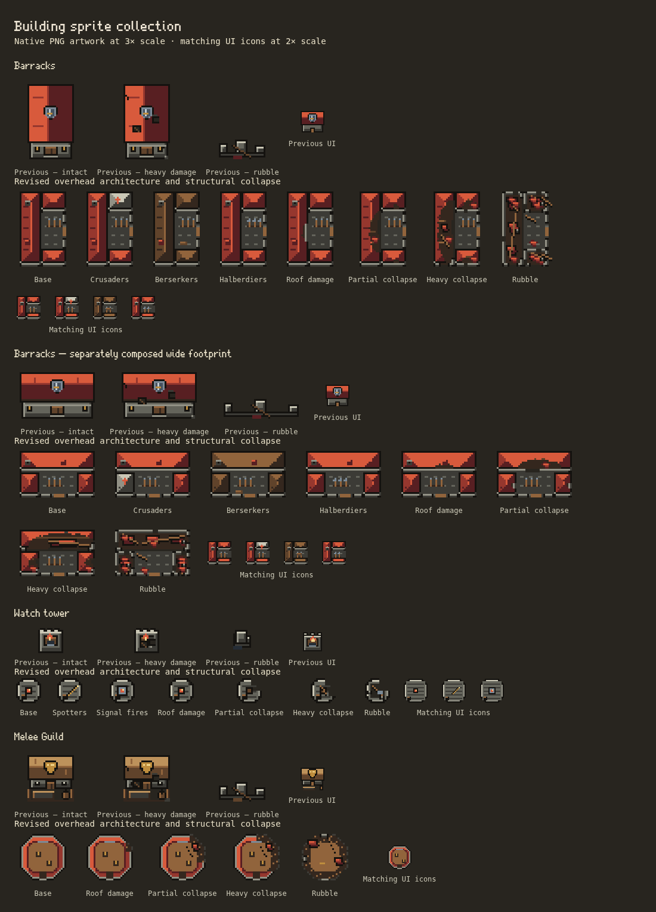

# Architecture and destruction revision 01

The first six sprite batches repeated rectangular roofs, large front-facing badges and a shared pile of rubble. This revision starts correcting that art direction with **Barracks, Melee Guild and Watch tower**. These are three calibration families, not a completed redraw of the catalog. The other twenty-two families still need architecture and destruction review; technical PNG coverage must not be reported as visual approval.



This sheet shows the actual runtime PNG frames at 3× native size and separately composed UI icons at 2×. The previous frames come from `ebb6dfb`. A separate generated concept explored building identities; its elevated camera and fine texture were unsuitable for direct use in Defend. The committed sprites use the established overhead grid and palette, rather than resizing that concept into the game.

## Changed architecture

| Family | Plan and identity | Collapse |
| --- | --- | --- |
| Barracks, normal and wide | Three roofed wings around a paved drill yard, equipment racks and an entrance. Separate compositions preserve both footprints. Crusaders retain a pale chapel wing, Berserkers timber roofing/storage, Halberdiers their weapon rack. | A failed roof bay grows across the longhouse, exposing floors and rafters; wall edges break away. Ruins retain room foundations, fallen roof panels and timber near the original wings. Path materials remain visible in ruins. |
| Melee Guild | Octagonal roofed training galleries around an open court, practice equipment and a south entrance. The arena silhouette distinguishes it from ordinary halls. | Galleries break away along the east edge. Exposed gallery flooring, displaced roof sections, rafters and low masonry remain around the court. |
| Watch tower | Octagonal stone lookout platform, parapet, stair hatch and a brazier; Spotters have a telescope and Signal fires a larger beacon. | The parapet and deck lose sections. Stone remnants and fallen equipment remain at the tower's footprint, without a hall's red roof debris. |

All world sizes, anchors, content bounds, path columns and frame rows stay unchanged. The four world sheets are `defend/barracks.png` (32×48 frames), `defend/barracks-wide.png` (48×32), `defend/melee-guild.png` (32×32) and `defend/watch-tower.png` (16×16), relative to `public/assets/pixel/v2/`. The three matching `ui/` sheets retain 24×24 icons. All seven files replace existing sheets in place; the other **54 native PNGs remain byte-identical**. No units or enemies are changed.

## Implementation and review

`scripts/pixel-art/architecture.ts` authors these building plans and their damage states. `drawing.ts` holds the shared native drawing primitives used by both the revised and existing families. `build.ts` writes the deterministic PNGs. No new browser drawing pass or runtime geometry generator is introduced.

`damageModel: "structural"` in the manifest distinguishes the revised families. Their frame bounds/pivots stay fixed while roof and wall silhouette pixels may disappear. The previous alpha-equality assertion made genuine structural collapse impossible; it remains enforced for untouched families. Structural checks verify silhouette loss and northern ruin remnants as well as the existing palette, opaque-alpha, footprint and anchor contracts. These checks cannot judge whether artwork is attractive or destruction looks believable; visual review remains necessary.

`paintStructureRubble` now accepts the selected path, supplied by the city layer, so a Crusaders ruin retains pale masonry and a Spotters ruin retains its equipment. Pixel Art off and unavailable PNGs continue through the exact legacy renderer. Existing placement, drag, rebuilding, UI and nearest-neighbor compositing routes remain in use.

The collection stays at **61 native PNG files, 406 world-state frames and 74 UI icons**. Decoded native-sheet storage is unchanged at **2,124,544 RGBA bytes**, before browser overhead. These seven files occupy the same 300,032 decoded bytes as their predecessors. They add no per-building allocation or cache.

Rebuild with `npm run sprites`; verify with `npm run sprites -- --check`. With the dev server running:

```sh
SPRITE_KINDS=barracks,meleeGuild,watchTower \
PLAYWRIGHT_EXECUTABLE=/usr/bin/chromium node tests/building-sprites.mjs
```

This limits the contact sheet, not test coverage. `SPRITE_COMPARE_DIR` optionally adds previous sheets using relative `defend/` and `ui/` directories. The committed comparison used originals copied from `ebb6dfb` into the ignored `test-results/art-direction-01/before/` directory. Tests need no historical files unless this option is set.

## Validation

- Full `npm test`: **590 passed, zero failed or skipped**. Production TypeScript/Vite build and deterministic PNG verification passed. The build retains its existing large-chunk warning.
- Targeted PNG checks: three tests passed, including reproducibility, palette/alpha, anchors and structural collapse checks. No gameplay golden was changed.
- Browser matrix: all 406 frames passed at 1100px/DPR1, 390px/DPR2 and 360px/DPR3, including native frame parity, exact legacy output, paths/rubble, UI/drag/placement, reconstruction, camera sampling, repeated toggles, motion and missing-PNG fallback.
- The real Settings checkbox persists its choice; desktop and phone whole-board checks passed. The earlier compact/airborne palace checks remain part of the browser suite.
- The existing stress fixture completed 120 recorded frames with 500 requested enemies (513 average including spawned enemies): update mean 4.02 ms, drawing mean 61.02 ms and combined work p95 139.90 ms. This is a whole-scene diagnostic under headless Chromium/software rendering with the Node suite running concurrently, not an isolated measurement of these sprites or a device frame-rate claim. Profiles and JSON are under ignored `test-results/stress-art-direction01.*`.

## Remaining review

Review these three families together on the board before copying architectural decisions across the remaining twenty-two. Those families still use the earlier art and generic damage/rubble treatment. Prioritize functional silhouettes for the Ranged Guild and ranged halls, recognizable tower platforms, distinct magical buildings and coherent materials in their ruins. City pieces, terrain and theme/UI artwork outside building icons remain pending in the inventory; units and enemies remain deferred.
