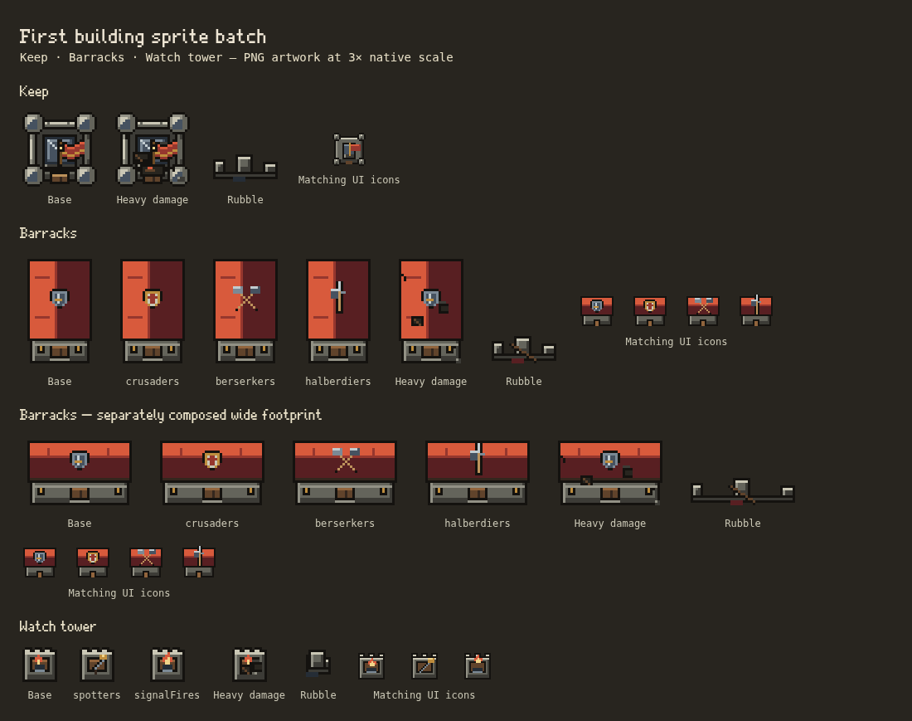

# Building sprite batch 01

The keep, barracks and watch tower now share clean outlines, quiet material planes, upper-left lighting and the [common palette](PIXEL_ART_GUIDE.md). All new images are PNG. Pixel Art checked selects them; unchecked retains the legacy procedural graphics. No unit or enemy artwork is changed in this batch.

## Delivered art

All paths below are relative to `public/assets/pixel/v2/`. The immutable manifest is `src/defend/building-sprite-manifest.ts`. Each world-sheet column is a path look. Rows are intact, successive damage stages, then rubble. There is a transparent border inside every frame; no sampling outside its declared source rectangle. None of these buildings has image overhang outside its logical footprint.

| Sheet | Native sheet | Frame / footprint | Anchor in frame | Looks / rows |
| --- | --- | --- | --- | --- |
| `defend/keep.png` | 32×192 | 32×32 / 4×4 cells | 16,16 | Base; intact + four damage stages + rubble |
| `defend/barracks.png` | 128×240 | 32×48 / 4×6 cells | 16,24 | Base, Crusaders, Berserkers, Halberdiers; intact + three damage stages + rubble |
| `defend/barracks-wide.png` | 192×160 | 48×32 / 6×4 cells | 24,16 | Separately composed wide hall; same looks/states; no stretched stones |
| `defend/watch-tower.png` | 48×80 | 16×16 / 2×2 cells | 8,8 | Base, Spotters telescope, Signal fires; intact + three damage stages + rubble |
| `ui/keep.png` | 24×24 | One 24×24 icon | Centered in control | Simplified keep and flag |
| `ui/barracks.png` | 96×24 | Four 24×24 icons | Centered in control | Base plus the three path emblems |
| `ui/watch-tower.png` | 72×24 | Three 24×24 icons | Centered in control | Beacon, telescope, signal fire |
| `defend/keep-flag.png` | 64×16 | Four 16×16 frames | 4,8 at the keep's world center | 0.2 seconds/frame; Reduce Motion uses frame zero |
| `defend/scaffold.png` | 8×8 | One simulation-cell module | Cell origin | Rebuilt sections of these families; no gameplay progress changes |

There are **61 world-state frames**, eight purpose-drawn UI icons, four flag frames and one scaffold module. Base world frames use 11–15 opaque colors; UI icons use 10–12. Damage uses the same palette, never fuzzy soot or extra blended shades. The original imported building PNGs remain in the repository as references; the migrated families use the new sheets or the legacy procedural fallback.

Keep upgrades currently retain the same building silhouette; existing live rank indicators, arrow/oil effects and the brick-health display remain data-driven. The barracks/watch-tower paths use the same look for their existing ranks, matching the game's current path-look semantics. Evolving into another building kind selects that family's existing renderer; future families are tracked separately in the [inventory](PIXEL_ART_INVENTORY.md).

## Integration and alignment

- All world art uses eight source pixels per cell: 64 per large tile and 16 per small placement square. Frame bounds, content bounds, footprints, pivots and zero overhang are explicit. Reject mismatched footprints instead of stretching a sheet.
- Board art, damage, rubble, palette/Tiles/upgrade canvases, carried icons and placement ghosts use the same family/path identity. Missing/loading/failed images draw the legacy alternative. Rebuilding uses the new one-cell scaffold only for these families.
- The keep's hit flash masks its actual PNG silhouette. Its flag shares the keep's ground center; it is independent of the planted war banner, whose art stays as before.
- Existing shared loaders preload each PNG once and invalidate city, combat and icon caches on image arrival/toggle. Held drag canvases now participate in icon redraws. No new timers, frame loops, save fields or simulation randomness.
- City compositing disables smoothing at the intermediate downsample step in pixel mode. Legacy/off retains its original smoothing behavior. Camera transforms, DPR handling, collision, input coordinates and placement rules are unchanged.
- Integer magnification is preferred. Fractional overview scales still sample source pixels unevenly with nearest-neighbor; authored overview detail tiers remain future work. The existing shared height-map lighting/shadows remain in use; they are not baked a second time into the PNGs.

## Source and review

`scripts/pixel-art/build.ts` contains editable native pixel drawings and a small deterministic RGBA PNG writer; it is build-time tooling, not procedural art shipped in the runtime bundle. Run `npm run sprites` after editing it, or `npm run sprites -- --check` to verify the committed files. New images are generated directly at native resolution without resizing the keep reference or any imported art.

`tests/building-sprites.test.ts` checks PNG reproducibility/signature, shared colors, hard alpha, dimensions, registry coverage, catalog footprints, path coverage, anchors and damage silhouette stability. `tests/building-sprites.mjs` checks all 61 frames against the PNG source, exact legacy pixels with the setting off, missing-PNG fallback, matching UI/drag/placement art, flash masks, flag motion and camera/DPR transforms at 1100/DPR1, 390/DPR2 and 360/DPR3. It also checks the real city's nearest-neighbor/off sampling behavior. Tests use isolated contexts and never a player's save.

Run the browser scripts with a dev server. `PLAYWRIGHT_EXECUTABLE=/usr/bin/chromium` selects Chromium in the cloud environment. `TEST_URL` can select a fresh dev server; restart Vite after renderer changes before direct-module browser checks to avoid mixing HMR module revisions. The contact sheet is generated at `test-results/building-sprites/contact-sheet.png`; `tests/pixel-art.mjs` records full-board on/off scenes and verifies Settings persistence. The existing pointer/keep fixtures cover dragging and upgrade-tree interactions.

The nine PNGs decode to **308,480 bytes (301.25 KiB)** before browser overhead; the keep flash adds one 32×32 cached mask. No per-building images or new unbounded caches are allocated. Whole-scene performance should continue to be checked with the repository's crowd/stress tools as subsequent families migrate.

## Validation record

- `npm test`: 552 passed. The final affected-area run adds damage, drag and edit-session coverage: 34 passed. Production TypeScript/Vite build and `npm run sprites -- --check` pass.
- Building sprite browser matrix passes all 61 world frames on desktop/DPR1, phone/DPR2 and phone/DPR3, including missing images, independent legacy references, UI/drag/placement art, masks, motion, reconstruction routing and sampling.
- `tests/pixel-art.mjs` passes: full registry loaded, board on/off screenshots, repeated toggles and saved real Settings choice. `tests/defend-keep.mjs` and `tests/defend-quarters.mjs` pass desktop and mobile interaction checks.
- The older `tests/defend-pointer.mjs` fails at line 150 before comparing its golden: it expects a tile-based `overlay.legal` entry for a barracks drag, which now uses the quarter-grid overlay. The identical failure was reproduced from an untouched `13c9fa6` checkout. No gameplay/pointer goldens were regenerated for these artwork changes.
- The existing 500-enemy tower/effects stress fixture completes a 120-frame profile (513 enemies on average after summons): 38.28 ms mean draw, 1.90 ms mean simulation update, 81.10 ms p95 combined work in headless Chromium/DPR1 on this cloud machine. Recordings are under `test-results/stress-building-sprites*.{json,png,cpuprofile}`. These are whole-scene smoke numbers with night, rain, units and combat effects active, not an isolated sprite-cost measurement or a claim of 60 FPS on devices.
