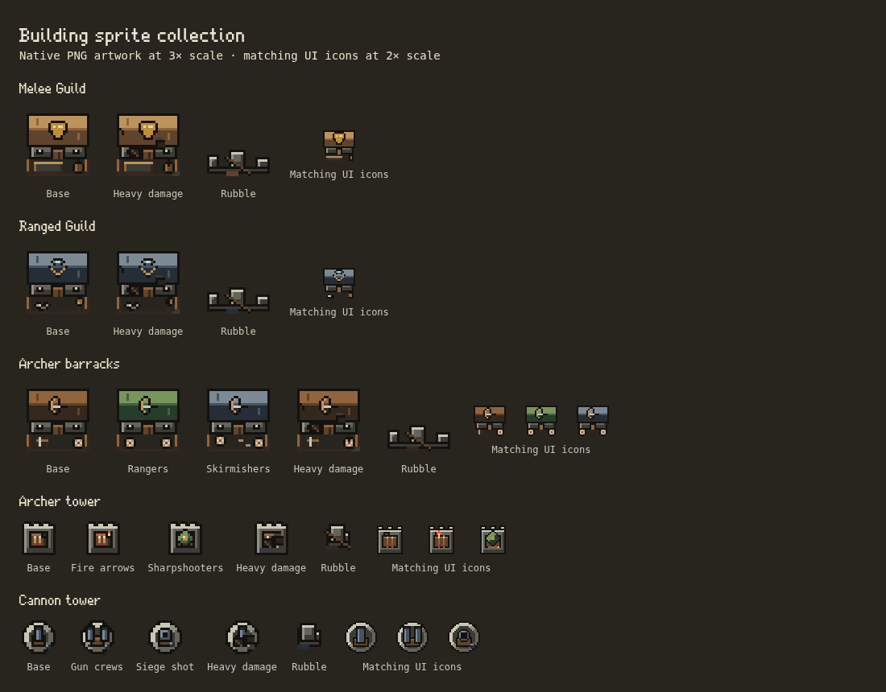

# Building sprite batch 02

This records the second delivery. [Batch 03](BUILDING_BATCH_03.md) extends the collection and browser matrix; the original ten PNG assets below are unchanged.

This batch adds the **Melee Guild, Ranged Guild, archer barracks, archer tower and cannon tower**, with matching building icons. They follow the palette, outline, lighting and native pixel scale established in [batch 01](BUILDING_BATCH_01.md). Units and enemies remain deferred.



## Delivered PNGs

Paths are relative to `public/assets/pixel/v2/`. World-sheet columns hold the base and path looks; rows hold intact, three damage stages and rubble. Each image uses hard alpha, at most 16 colors per standing world frame and at most 12 per UI icon.

| World sheet / UI sheet | World sheet size | Native frame / cell footprint | Ground anchor | Looks |
| --- | --- | --- | --- | --- |
| `defend/melee-guild.png` / `ui/melee-guild.png` | 32×160 | 32×32 / 4×4 | 16,16 | Straw-colored hall, fist emblem, sparring ring and punching bag |
| `defend/ranged-guild.png` / `ui/ranged-guild.png` | 32×160 | 32×32 / 4×4 | 16,16 | Slate hall, sling emblem, throwing stones and target pot |
| `defend/archer-barracks.png` / `ui/archer-barracks.png` | 96×160 | 32×32 / 4×4 | 16,16 | Base bow rack and target; Rangers' green roof and paired targets; Skirmishers' dark roof and staggered stations |
| `defend/archer-tower.png` / `ui/archer-tower.png` | 48×80 | 16×16 / 2×2 | 8,8 | Base arrow platform; Fire arrows' embers and burning arrowheads; Sharpshooters' green canopy |
| `defend/cannon-tower.png` / `ui/cannon-tower.png` | 48×80 | 16×16 / 2×2 | 8,8 | Round platform and north-facing gun; Gun crews' twin barrels; Siege shot's large mortar |

The two guild UI sheets are 24×24; the other three are 72×24, each containing three purpose-drawn 24×24 icons. Total delivery: **ten PNG files, 55 world-state frames and 11 UI icons**. No first-batch PNG is changed. The complete collection now has eight of the sixteen building families, 19 PNG files, 116 world-state frames and 19 UI icons, plus the existing four flag frames and scaffold module.

## Shared rendering contract

- World art uses **eight source pixels per simulation cell**: 16 per small placement square and 64 per large defense tile. Every new family declares its exact catalog footprint, content bounds, center anchor and zero overhang in `building-sprite-manifest.ts`. Neither the grid nor the camera is changed.
- Existing `pixel-sprites.ts` registration, image loading and cache revisions cover the new manifest entries automatically. Pixel Art checked selects the new PNGs. Unchecked selects the original procedural graphics, with the same paths, damage and rubble as before. Failed/loading world sheets use the existing fallback.
- The same identity appears on the board, in the build palette, Tiles, building-tree icons, carried icons and placement ghosts. New families use the existing whole-footprint rubble route and one-cell PNG scaffold for partial rebuilding. No new frame loops, timers or per-building image instances.
- Both guilds have a base look; promotions change their catalog kind and select that kind's renderer. Rangers, Skirmishers, Fire arrows, Sharpshooters, Gun crews and Siege shot retain their path looks through all three damage stages. Existing numerical ranks within a path share the same look, as in the legacy renderer. Advanced promoted buildings remain separate inventory work.
- Rubble is deliberately shared across a family's paths after its roof/weapons collapse; its material comes from the family. The cannon remains north-facing, matching the existing renderer. Projectiles, firing/impact effects, combat rules, unit sprites, terrain and shared lighting/shadows are unchanged.
- All source artwork is authored at native size in `scripts/pixel-art/build.ts`. The new typed painter table covers every manifest key; roofs, emblems, targets and equipment are composed directly on the pixel grid. UI icons have their own compositions. `npm run sprites` produces the PNGs, and `npm run sprites -- --check` verifies them.

## Review and checks

`tests/building-sprites.test.ts` validates the full collection's reproducible PNG bytes, palette/alpha limits, image registration, frame dimensions, content bounds, path coverage, anchors and unchanged damage silhouettes. It now includes base-only guild families with no `PATH_LOOKS` entry.

`tests/building-sprites.mjs` derives its expected frame count from the manifest and checks **all 116 frames** at 1100 CSS pixels/DPR1, 390/DPR2 and 360/DPR3. It compares the new source frames, UI icons and placement ghosts, then independently compares legacy pixels with the setting off; it checks repeated toggles, failed PNG loads, actual city-layer reconstruction/sampling, keep masks/motion and camera input transforms. `tests/pixel-art.mjs` checks the full 54-image registry, whole-board on/off rendering and the real saved Settings checkbox. All browser tests use isolated contexts, never player saves.

To regenerate this batch's contact sheet while still testing the whole collection:

```sh
SPRITE_KINDS=meleeGuild,rangedGuild,archerBarracks,archerTower,cannonTower \
PLAYWRIGHT_EXECUTABLE=/usr/bin/chromium node tests/building-sprites.mjs
```

Use `TEST_URL` for a fresh dev server when needed. The generated preview is `test-results/building-sprites/contact-sheet.png`; the reviewed copy above is committed with this document. Batch-01's preview stays unchanged.

The ten new PNGs total 5,320 compressed bytes and **158,464 decoded RGBA bytes (154.75 KiB)** before browser overhead. The complete collection decodes to 456 KiB. Existing bounded image/layer caches own the new assets; steady-state rendering adds no new passes or animation work. Fractional overview scales and the wider game's remaining UI/terrain art still have the limitations tracked in the [guide](PIXEL_ART_GUIDE.md) and [inventory](PIXEL_ART_INVENTORY.md).

## Validation record

- Full `npm test`: **552 passed**. Final focused art/damage/path checks: 25 passed. Production TypeScript/Vite build and `npm run sprites -- --check` pass.
- Browser art matrix: all 116 registered world frames pass at desktop/DPR1, phone/DPR2 and phone/DPR3, including legacy/failure fallback, paths, icons, ghosts, rebuilding, camera mapping and sampling. The real Settings/whole-board pixel-art checks pass with all 54 registered images loaded.
- Existing quarter-grid drag/placement fixture passes at 1280 and 390 CSS pixels. Gameplay/pointer goldens are unchanged; the older pointer fixture's pre-existing issue remains recorded in batch 01.
- The 500-enemy tower/effects stress fixture completes 120 profiled frames, averaging 513 enemies after summons. Headless Chromium/DPR1 on this cloud machine: 37.59 ms mean draw, 1.75 ms mean simulation update, 81.40 ms p95 combined work. JSON, screenshot and CPU profile are in `test-results/stress-building-batch02.*`. These are whole-scene smoke measurements with night, rain and combat effects active, not a device FPS guarantee or an isolated sprite benchmark.
