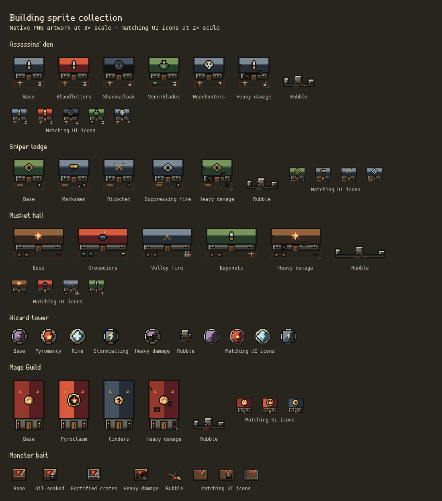

# Building sprite batch 03

This batch adds the **Assassins' den, Sniper lodge, Musket hall, Wizard tower, Mage Guild and Monster bait**, including all their existing path looks, damage, rubble, rebuilding and matching building icons. Units and enemies remain deferred. Earlier sprites retain their original PNG bytes.



## Delivered PNGs

Paths are relative to `public/assets/pixel/v2/`. World-sheet columns are base + path looks; rows are intact, three damage stages, then rubble. Native scale remains eight pixels per simulation cell, sixteen per small placement square and sixty-four per large defense tile. All new frames have zero footprint overhang.

| World sheet / UI sheet | World sheet size | Native frame / footprint in cells | Anchor | Looks |
| --- | --- | --- | --- | --- |
| `defend/assassin-den.png` / `ui/assassin-den.png` | 160×160 | 32×32 / 4×4 | 16,16 | Base, Bloodletters, Shadowcloak, Venomblades, Headhunters |
| `defend/sniper-lodge.png` / `ui/sniper-lodge.png` | 128×160 | 32×32 / 4×4 | 16,16 | Base, Marksmen, Ricochet, Suppressing fire |
| `defend/musket-hall.png` / `ui/musket-hall.png` | 192×160 | 48×32 / 6×4 | 24,16 | Base, Grenadiers, Volley fire, Bayonets |
| `defend/wizard-tower.png` / `ui/wizard-tower.png` | 64×80 | 16×16 / 2×2 | 8,8 | Base, Pyromancy, Rime, Stormcalling |
| `defend/mage-guild.png` / `ui/mage-guild.png` | 96×240 | 32×48 / 4×6 | 16,24 | Base, Pyroclasm, Cinders |
| `defend/monster-bait.png` / `ui/monster-bait.png` | 48×80 | 16×16 / 2×2 | 8,8 | Base, Oil-soaked, Fortified crates |

UI frames are purpose-composed at 24×24. The den sheet is 120×24, the Sniper/Musket/Wizard sheets are 96×24, and the Mage/Bait sheets are 72×24. Total: **twelve PNG files, 115 world-state frames and 23 UI icons**.

The collection now covers **fourteen of sixteen building families**, with 31 native PNG sheets, 231 world-state frames and 42 matching UI icons, plus the existing flag/scaffold images. Valkyrie palace and Dark wizard keep remain pending, including their compact and special rendering cases.

## Art direction and integration

- Stone, timber, steel, brass and cloth retain the earlier material ramps, crisp one-pixel outlines, quiet surfaces and upper-left lighting. The shared palette gains just two controlled three-color ramps: violet (`#352943`, `#65567D`, `#A391B3`) and frost (`#325B70`, `#6FA3B8`, `#C2E5E6`). The collection has 30 swatches, with the same limits of **16 opaque colors per standing world frame and 12 per UI icon**. No antialiased sprite alpha, blur, generated noise or external sprite pack.
- Den paths use distinct blade, hood, vial and skull insignia and appropriate yard equipment; these are building emblems/props, not unit sprites. Sniper paths use a sight, brass spyglass, ricochet track or bright crosshair with targets/defensive rails. Musket paths use powder burst, grenade, crossed muskets or bayonet equipment and matching racks/stock.
- Wizard paths change the roof silhouette as well as its material and finial: violet octagon, fire hexagon, frost diamond, storm square. Stone foundations and a south-facing entrance remain legible. Mage paths have the base fire well, a larger Pyroclasm well, or a charcoal roof/ember hearth for Cinders; the UI also distinguishes the larger well. Bait retains meat/bone cargo, an oil pot or iron straps; its rubble is broken timber and spilled cargo, not masonry.
- Existing numerical ranks within each path share the same building look, matching the game's current path-look semantics. Rubble is shared across each family's paths after its equipment collapses. All path and damage frames retain their declared footprint, pivot and silhouette bounds; wide Musket halls and tall Mage Guilds use their actual catalog orientation, never stretched square images.
- The shared manifest registers these PNGs automatically with the existing loader/cache revision. **Pixel Art checked selects the new sprites; unchecked restores the exact legacy drawings.** Loading/failed world sheets keep the existing fallback. Build palette, Tiles, building-tree canvases, carried icons and placement ghosts share the same family/path identity. Rebuilding uses the existing one-cell PNG scaffold.
- No setting defaults, fonts, save fields, stats, simulation randomness, collision, input mapping, projectiles, unit/enemy images or game frame loops change. Lighting and shadows remain shared renderer layers. New asset selection uses the existing rendering paths, with no per-building image allocation.

## Reproduction and review

`scripts/pixel-art/build.ts` contains the editable native drawings. `building-sprite-manifest.ts` records exact frame sizes, content bounds, anchors, footprints, paths and overhangs. Run `npm run sprites` to rebuild, or `npm run sprites -- --check` to verify the committed PNGs. All nineteen earlier sprite files are unchanged.

The existing asset tests automatically cover every new file: reproducibility, PNG signature/decoding, palette/alpha limits, catalog footprints, every path, frame dimensions, content bounds and stable damage silhouettes. Browser checks exercise all 231 world frames at desktop/DPR1, phone/DPR2 and phone/DPR3, compare on/off rendering against independent legacy pixels, and check failed-image fallback, UI/drag/placement images, keep motion/masks, real reconstruction routing, sampling and camera transforms. The saved Settings/whole-board test covers the complete 66-image registry.

Generate this batch's contact sheet while keeping all-family test coverage:

```sh
SPRITE_KINDS=assassinDen,sniperLodge,musketHall,wizardTower,mageGuild,monsterBait \
PLAYWRIGHT_EXECUTABLE=/usr/bin/chromium node tests/building-sprites.mjs
```

A dev server is required; set `TEST_URL` to select it. The generated sheet is `test-results/building-sprites/contact-sheet.png`; its reviewed copy is committed above. All browser fixtures use isolated contexts and never a player's save.

The twelve new files decode to **488,192 RGBA bytes (476.75 KiB)** before browser overhead. The entire clean building PNG collection decodes to **932.75 KiB**. No new animation passes or unbounded caches are introduced. Fractional overview sampling, remaining UI/theme/terrain artwork and the two large building families are still tracked in the [guide](PIXEL_ART_GUIDE.md) and [inventory](PIXEL_ART_INVENTORY.md).
