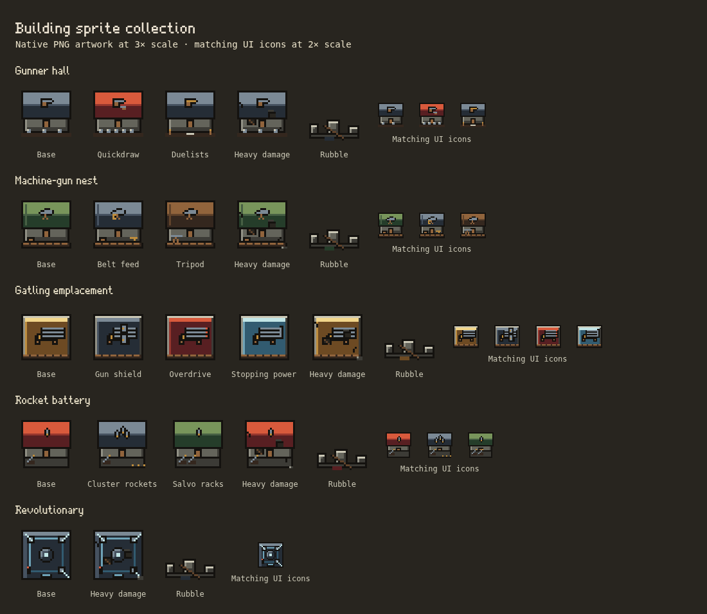

# Building sprite batch 04

This batch adds **Gunner hall, Machine-gun nest, Gatling emplacement, Rocket battery and Revolutionary**. It includes all current path looks, three damage stages, rubble and matching UI icons. Units and enemies remain deferred. All 31 earlier PNG files retain their exact bytes.



## Delivered PNGs

Paths are relative to `public/assets/pixel/v2/`. Every world frame is **32×32**, covering its catalog **4×4-cell** footprint at eight pixels per cell, with anchor **16,16**, content bounds **3,3,26,26** and zero overhang. World-sheet columns are base/path looks; its five rows are intact, three damage stages and rubble. UI icons are separately composed at **24×24**, preserving one-pixel edges rather than downscaling the world frames.

| World / UI file stem | World sheet | UI sheet | Looks |
| --- | --- | --- | --- |
| `defend/gunner-hall.png` / `ui/gunner-hall.png` | 96×160 | 72×24 | Base, Quickdraw, Duelists |
| `defend/machine-gun-nest.png` / `ui/machine-gun-nest.png` | 96×160 | 72×24 | Base, Belt feed, Tripod |
| `defend/gatling-emplacement.png` / `ui/gatling-emplacement.png` | 128×160 | 96×24 | Base, Gun shield, Overdrive, Stopping power |
| `defend/rocket-battery.png` / `ui/rocket-battery.png` | 96×160 | 72×24 | Base, Cluster rockets, Salvo racks |
| `defend/revolutionary.png` / `ui/revolutionary.png` | 32×160 | 24×24 | Base; shared numerical upgrades retain this look |

Total: **ten PNG files, 70 world-state frames and 14 UI icons**. The full collection now covers **nineteen of twenty-one building families**, with **41 native PNG files, 316 world-state frames and 59 UI icons**, plus the existing flag frames and one-cell scaffold. Valkyrie palace and Dark wizard keep remain pending, including their compact and special sky rendering.

## Art direction and integration

- Gunner halls have steel roofs and pistol signs. Quickdraw brings a red roof, second pistol and extra targets; Duelists has a brass pistol and two posts flanking a measured lane.
- Machine-gun nests have quiet canvas roofs with one seam, a gun sign, sandbagged yards and ammunition crates. Belt feed uses steel canvas and a brass belt; Tripod uses a timber roof and a supported gun in the yard.
- Gatling emplacements have open platforms, wheeled carriages and three barrel lines. Gun shield adds a riveted steel plate with a sight slot; Overdrive has a red platform and hot barrel tips; Stopping power has a frost-blue platform and a wide muzzle.
- Rocket batteries have a rocket sign, launch pad and slanted rack. Cluster rockets adds a bundle and spent ammunition; Salvo racks has a green roof and a second rack.
- Revolutionary has a gunmetal roof, inset cyan conduit, central sensor, three corner perches and one red warning lamp. Existing laser effects stay separate from the PNG, so no targeting beam is baked into a static building.
- All use the existing shared **30-color palette**, upper-left lighting, one-pixel outlines and quiet material planes. Standing world frames remain at or below **16 opaque colors**, UI at or below **12**. Alpha is entirely opaque or transparent. No SVG sprite, new color ramp, external pack, texture noise or runtime painter is introduced.
- All states retain the same footprint, pivot and bounds. Path ranks share their path's building look; the Revolutionary's shared numerical upgrades share its one building identity. Collapsed equipment uses the family's masonry/roof rubble. Reconstruction uses the existing native one-cell scaffold.
- Manifest registration reuses the established loader and cache revision, world/rubble routes, path-aware UI, drag previews and placement ghosts. **Pixel Art checked displays these PNGs; unchecked restores the exact legacy drawings.** Missing/loading images use the existing fallback. No setting defaults, gameplay stats, saved fields, RNG, collisions, projectiles, unit/enemy art or animation loops change.

## Reproduction and review

Editable drawings live in `scripts/pixel-art/build.ts` (`gunnerHall`, `gunnerSign`, `gatlingEmplacement`, `revolutionary`). The shared manifest holds all frame metadata and path lists. Run `npm run sprites` to rebuild or `npm run sprites -- --check` to verify deterministic output.

Generate the batch preview while retaining all-family browser coverage:

```sh
SPRITE_KINDS=gunHall,gunNest,gatlingNest,rocketBattery,revolutionary \
PLAYWRIGHT_EXECUTABLE=/usr/bin/chromium node tests/building-sprites.mjs
```

A dev server is required; set `TEST_URL` to select it. The contact sheet is generated under `test-results/building-sprites/`; the reviewed copy is committed above. Fixtures use isolated contexts and never a player's save. Earlier batch previews and PNGs remain unchanged.

The ten new files decode to **318,976 RGBA bytes (311.5 KiB)** before browser overhead. The full clean PNG collection decodes to **1,352,704 bytes (1,321 KiB)**. The shared registry now contains 76 images including the 35 original imports; this batch adds no new rendering passes or unbounded caches.

## Validation record

- Full `npm test` passed: **579 tests, zero failures**.
- Reproducible PNG/palette/alpha/footprint tests and the production TypeScript/Vite build passed. All 31 earlier PNG files remain byte-identical, and all 41 current native PNGs are copied unchanged to `dist/`.
- Browser checks passed all **316 world frames** at 1100px/DPR1, 390px/DPR2 and 360px/DPR3, including exact legacy/off parity, repeated toggles, matching icons, drag/placement, reconstruction, reduced motion, camera transforms and missing-PNG fallback. Saved Settings and whole-board checks passed with the complete 76-image registry.
- Existing `defend-gunners.mjs` and `defend-revolutionary.mjs` passed at desktop 1280px and phone 390px: buildings stand wearing their paths, their upgrade trees work, and battle/laser behavior continues correctly. No gameplay goldens were regenerated.
- The existing stress scene completed 120 recorded frames with 500 requested enemies (513 average including spawns): simulation mean 5.60 ms, drawing mean 88.32 ms, combined work p95 248.00 ms. This headless Chromium 154/DPR1 run used SwiftShader/software Canvas while other browser and Node checks ran concurrently; it measures the instrumented whole scene under contention, not this batch's isolated sprite cost or player-device frame rate. JSON, CPU profile and screenshot are generated under `test-results/stress-building-batch04.*`.
