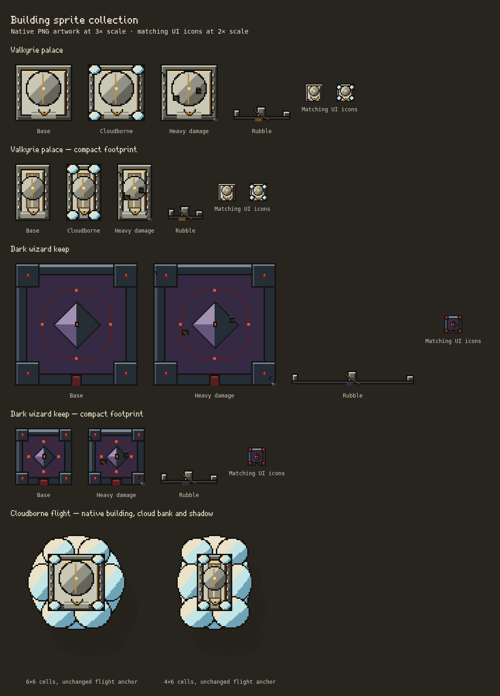

# Building sprite batch 05

This batch adds **Valkyrie palace and Dark wizard keep**, each in normal and compact catalog sizes, with damage, rubble and purpose-drawn UI icons. It also converts the palace's separate **Cloudborne flight renderer**, including its cloud bank, shadow and ground mooring. Units and enemies remain deferred. All 41 earlier PNG files retain their exact bytes.



## Delivered PNGs

Paths are relative to `public/assets/pixel/v2/`. Every building uses eight native pixels per simulation cell, zero building overhang, centered anchors and three-pixel outer padding. World sheets have columns for base/path looks and five rows: intact, three damage stages, rubble. Normal and compact layouts are composed at their actual native dimensions, never resized versions of each other.

| World sheet | Native frame / cells | Sheet size | Anchor | Content bounds | Looks |
| --- | --- | --- | --- | --- | --- |
| `defend/valkyrie-palace.png` | 48×48 / 6×6 | 96×240 | 24,24 | 3,3,42,42 | Base, Cloudborne |
| `defend/valkyrie-palace-compact.png` | 32×48 / 4×6 | 64×240 | 16,24 | 3,3,26,42 | Base, Cloudborne |
| `defend/dark-keep.png` | 96×96 / 12×12 | 96×480 | 48,48 | 3,3,90,90 | Base |
| `defend/dark-keep-compact.png` | 48×48 / 6×6 | 48×240 | 24,24 | 3,3,42,42 | Base |

`ui/valkyrie-palace.png` is 48×24 (base and Cloudborne); `ui/dark-keep.png` is 24×24. Each family shares its purpose-composed 24×24 UI frames between normal/compact buildings.

Six more PNGs support Cloudborne flight:

| Layer | Normal / compact pixels | Anchor / footprint |
| --- | --- | --- |
| `defend/palace-clouds.png`, `defend/palace-clouds-compact.png` | 80×80 / 64×80 | 40,40 / 32,40; two extra cells per side around the unchanged palace footprint |
| `defend/palace-shadow.png`, `defend/palace-shadow-compact.png` | 80×80 / 64×80 | Same cloud silhouette and anchors, with checker transparency |
| `defend/palace-mooring.png`, `defend/palace-mooring-compact.png` | 48×48 / 32×48 | 24,24 / 16,24; exact ground footprint, no overhang |

Total: **twelve PNG files, 30 building world-state frames, three UI frames and six special layer images**. The complete collection now has **53 native PNG files, 346 world-state frames and 62 UI frames**, plus flag/scaffold and airborne layers. Coverage is **twenty-one of twenty-five building families**: main gained Spearmen hall, Phalanx, Javelin camp and Lancer stable before this batch began; their sprites remain pending.

## Art direction and integration

- The palace uses quiet pale masonry, a regular colonnade, gold-edged central dome and wing insignia over the south steps. Compact keeps the same pixel density with fewer columns, a long gold roof ridge and a smaller dome. Cloudborne adds contained corner clouds; the airborne bank extends outside the footprint with separately documented margins.
- The Dark wizard keep uses dark steel/obsidian planes, four ruby-lit corner towers, a central violet spire, restrained crimson enclosure and a south gate. The compact layout preserves those identities with smaller towers and fewer details. No tiled noise or random surface speckle is baked into the drawings.
- The existing shared **30-color palette** remains unchanged. Standing world frames use at most **16 opaque colors**, UI at most **12**; alpha remains 0 or 255. Lighting is from the upper left, outlines are one native pixel, and no SVG sprite or procedural texture noise is introduced.
- Standing, rubble, reconstruction, UI, carried icons and placement previews use the common manifest routes. Compact metadata is checked against the catalog's actual `compact` dimensions. Shared UI files are emitted once, including the existing normal/wide barracks case.
- `SkyPalaceArt` selects the native roof, cloud bank and checker shadow **only when all three images are ready**; otherwise it keeps the complete original airborne composition. The city layer selects the native mooring independently, with legacy fallback. Both branches honor Pixel Art and the existing image revision/cache behavior.
- A bounded two-canvas composition cache applies fading to the complete cloud/roof image once, preventing opacity from accumulating over overlaps. Flight position, whole-art-pixel bob, opacity transitions over the city, night lighting, Reduce Motion and shadow offsets remain unchanged. No footprints, targeting, collisions, troop behavior, saves, gameplay RNG or unit/enemy artwork change.

## Reproduction and verification

Editable native drawings are in `scripts/pixel-art/build.ts` (`palace`, `darkKeep`, `palaceClouds`, `palaceMooring`). Frame metadata and `PALACE_SKY` margins/anchors live in `building-sprite-manifest.ts`. Run `npm run sprites` to rebuild or `npm run sprites -- --check` to verify deterministic delivery.

```sh
SPRITE_KINDS=valkyriePalace,darkKeep \
PLAYWRIGHT_EXECUTABLE=/usr/bin/chromium node tests/building-sprites.mjs
```

A dev server is required; `TEST_URL` selects it. The generated contact sheet is under `test-results/building-sprites/`; the reviewed copy above includes both actual flight compositions. All fixtures use isolated contexts and never a player's save.

The twelve new files decode to **498,432 RGBA bytes (486.75 KiB)** before browser overhead; the full native collection decodes to **1,851,136 bytes (1,807.75 KiB)**. The shared loader now registers 88 images including its 35 original imports. Images load once and use existing cache revisions; the cloud and roof are composed in two reusable canvases (one per footprint, 46,080 RGBA bytes / 45 KiB combined) before fading, preserving one opacity application across overlaps. Composition redraws only on image/setting revision; steady flight retains two image draws (shadow and body), with no new animation loop or per-building image allocation.

## Validation record

- Final `npm test` passed after the opacity/cache correction: **590 tests, zero failures**.
- Targeted PNG and Cloudborne tests passed: **10 tests** covering deterministic delivery, shared palette/alpha, normal/compact footprints, stable damage bounds, cloud anchors/margins and matching checker shadows, plus existing flight mechanics.
- Browser matrix passed **346 building frames** at desktop 1100px/DPR1, phone 390px/DPR2 and phone 360px/DPR3. It includes exact native and legacy pixels, UI/drag/placement, reconstruction, camera transforms and motion checks.
- New browser assertions compare the actual flying renderer against independent legacy pixels and exact native roof/cloud/shadow composition in both sizes, verify repeat toggles, exact 0.1-opacity flight pixels over people and the real city-layer mooring route, and check full and partial PNG failures.
- Existing `defend-sky-palace.mjs` passed at desktop 1280px and phone 390px: the building/tree remains selectable, opacity is 1 over open ground and 0.1 over the city, and drifting/wrapping still works. Saved Settings/whole-board checks passed with all 88 images.
- Production TypeScript/Vite build and reproducible PNG check passed; all 41 earlier PNGs are byte-identical and all 53 current files are copied unchanged to `dist/`. No gameplay golden was regenerated.
- The existing grounded compact-building stress fixture completed 120 recorded frames with 500 requested enemies (513 average including spawned enemies): simulation mean 2.18 ms, drawing mean 47.97 ms and combined work p95 103.90 ms. This is a whole-scene diagnostic in headless Chromium 154/DPR1 using SwiftShader/software Canvas with the Node suite running concurrently, not isolated sprite cost or a player-device frame-rate claim. The fixture grounds its palaces; airborne composition instead has the separately bounded 45 KiB cache and two steady image draws described above. JSON, CPU profile and screenshot are generated under `test-results/stress-building-batch05-final.*`.
