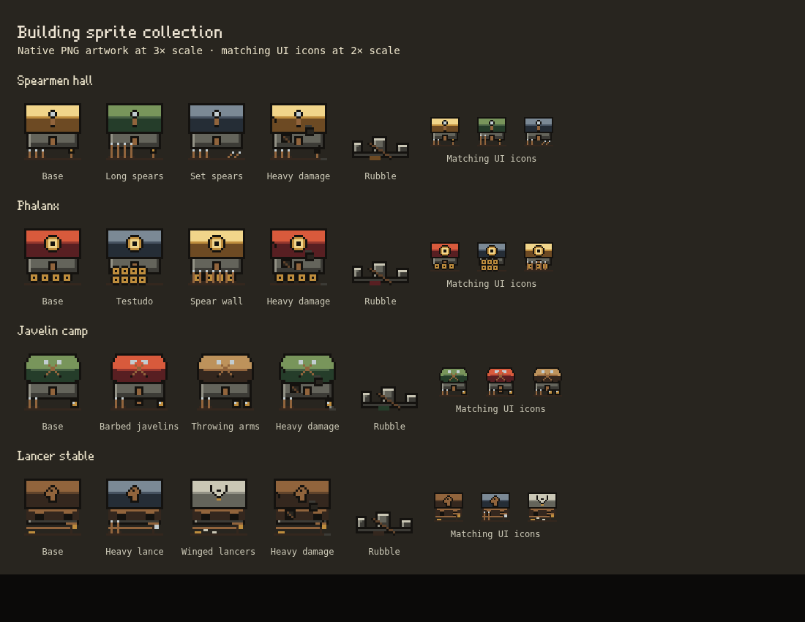

# Building sprite batch 06

This batch adds **Spearmen hall, Phalanx, Javelin camp and Lancer stable**, including all eight current path looks, damage, rubble, rebuilding and matching building icons. It completes native PNG coverage for the **twenty-five current catalog building families**. City pieces, housing, environment art and other unchecked inventory rows remain future work. Units and enemies remain deferred; no troop, mount or enemy sprite is added. All 53 earlier PNG files retain their exact bytes.



## Delivered PNGs

Paths are relative to `public/assets/pixel/v2/`. Each world frame is **32×32** for its catalog **4×4-cell** footprint at eight pixels per cell, with anchor **16,16**, content bounds **3,3,26,26** and zero overhang. Columns are base/path looks; the five rows are intact, three damage stages, rubble. Each UI frame is separately composed at **24×24**, preserving one-pixel details rather than downscaling the world sheet.

| World sheet / UI sheet | World sheet | UI sheet | Looks |
| --- | --- | --- | --- |
| `defend/spearmen-hall.png` / `ui/spearmen-hall.png` | 96×160 | 72×24 | Base, Long spears, Set spears |
| `defend/phalanx.png` / `ui/phalanx.png` | 96×160 | 72×24 | Base, Testudo, Spear wall |
| `defend/javelin-camp.png` / `ui/javelin-camp.png` | 96×160 | 72×24 | Base, Barbed javelins, Throwing arms |
| `defend/lancer-stable.png` / `ui/lancer-stable.png` | 96×160 | 72×24 | Base, Heavy lance, Winged lancers |

Total: **eight PNG files, 60 world-state frames and 12 UI frames**. The complete collection now has **61 native PNG files, 406 world-state frames and 74 UI frames**, plus the existing flag/scaffold and airborne layer images. Normal, wide and compact catalog footprints retain their earlier authored layouts.

## Art direction and integration

- Spearmen hall has ochre roofing, a spear sign, rack and training dummy. Long spears has green roofing with taller/more numerous spears; Set spears has steel roofing and braced stakes along the fence.
- Phalanx has red roofing and a round brass shield sign. Testudo has steel roofing and shields packed into two rows; Spear wall has brass roofing and a hedge of spear points before its shields. These are stored equipment props, not people.
- Javelin camp uses stepped canvas eaves, a ridge, crossed javelin sign, rack and target. Barbed javelins has a wine-red canopy, hooked sign and hide rack; Throwing arms has a pale canvas roof and a second target.
- Lancer stable has a timber facade with two open bays, a heraldic horse-head sign, training rail, quintain and hay. Heavy lance has a steel roof, lance rack and reinforced target; Winged lancers has pale roofing, a wing sign and a few feather marks. The horse head is a building emblem; no animal or mounted-unit sprite is introduced.
- The shared **30-color palette** is unchanged. Each standing world frame stays at or below **16 opaque colors**, UI at or below **12**; alpha is 0 or 255. Lighting is from the upper left, outlines are one native pixel and material planes remain quiet. No SVG sprite, external art pack, antialiasing or texture noise is added.
- Every path's ranks share its authored look, matching the existing path semantics. Damage frames retain identical bounds and silhouette; rubble shares each family's collapsed foundation/roof identity. Reconstruction uses the existing one-cell PNG scaffold.
- Manifest registration reuses the established image loader/cache revision and world, rubble, UI, drag and placement routes. **Pixel Art checked displays these PNGs; unchecked restores exact legacy graphics.** Missing/loading images retain the established fallback. No runtime renderer, setting defaults, simulation state, stats, saves, RNG, collision, projectiles or animation loops change.

## Reproduction and verification

Editable native drawings are in `scripts/pixel-art/build.ts` (`spearBuilding`, `spearSign`, `roundShield`, `nativeSpearRack`). Frame metadata and ordered path lists are in `building-sprite-manifest.ts`. Run `npm run sprites` to rebuild or `npm run sprites -- --check` to verify deterministic delivery.

```sh
SPRITE_KINDS=spearHall,phalanx,javelinCamp,lancerStable \
PLAYWRIGHT_EXECUTABLE=/usr/bin/chromium node tests/building-sprites.mjs
```

A dev server is required; `TEST_URL` selects it. The generated contact sheet is under `test-results/building-sprites/`; the reviewed copy is committed above. All fixtures use isolated contexts and never a player's save. Earlier PNGs and preview images remain unchanged.

The eight new files decode to **273,408 RGBA bytes (267 KiB)** before browser overhead. The entire native PNG collection decodes to **2,124,544 bytes (2,074.75 KiB)**. The shared loader now registers 96 images including the original 35 imports. This batch adds no rendering pass, per-building image allocation or unbounded cache.

## Validation record

- Full `npm test` passed: **590 tests, zero failures**.
- Targeted PNG and spearmen tests passed: **13 tests**, including deterministic PNG output, palette/alpha limits, catalog footprints, anchors, unchanged damage silhouettes, every path and the existing spear-line behavior.
- Browser matrix passed all **406 building frames** at desktop 1100px/DPR1, phone 390px/DPR2 and phone 360px/DPR3. This covers exact native/legacy pixels, repeated toggles, UI/drag/placement, reconstruction, camera transforms, motion and missing-asset fallback, plus the earlier compact/airborne palace checks.
- Existing `defend-spears.mjs` passed at desktop 1280px and phone 390px: the buildings stand wearing their paths, the Spearmen hall and Lancer stable upgrade trees work, and the existing spearmen, hoplites, javelineers and lancers still fight correctly. No unit art is changed by this batch.
- Saved Settings/whole-board checks passed with the complete 96-image registry. The production TypeScript/Vite build and reproducible PNG check passed. All 53 earlier PNG files are byte-identical; all 61 current native PNGs are copied unchanged to `dist/`. No gameplay golden was regenerated.
- An independent catalog check confirmed every one of the current 25 `STRUCTURES` families has native PNG metadata. This does not mark city walls, houses, gates, terrain or other unchecked inventory rows complete.
- The existing mixed-scene stress fixture completed 120 recorded frames with 500 requested enemies (513 average including spawned enemies): simulation mean 1.85 ms, drawing mean 39.68 ms and combined work p95 84.60 ms. This is a whole-scene diagnostic in headless Chromium 154/DPR1 using SwiftShader/software Canvas with the Node suite running concurrently, not an isolated measurement of these four sprites or a player-device frame-rate claim. JSON, CPU profile and screenshot are generated under `test-results/stress-building-batch06.*`.
