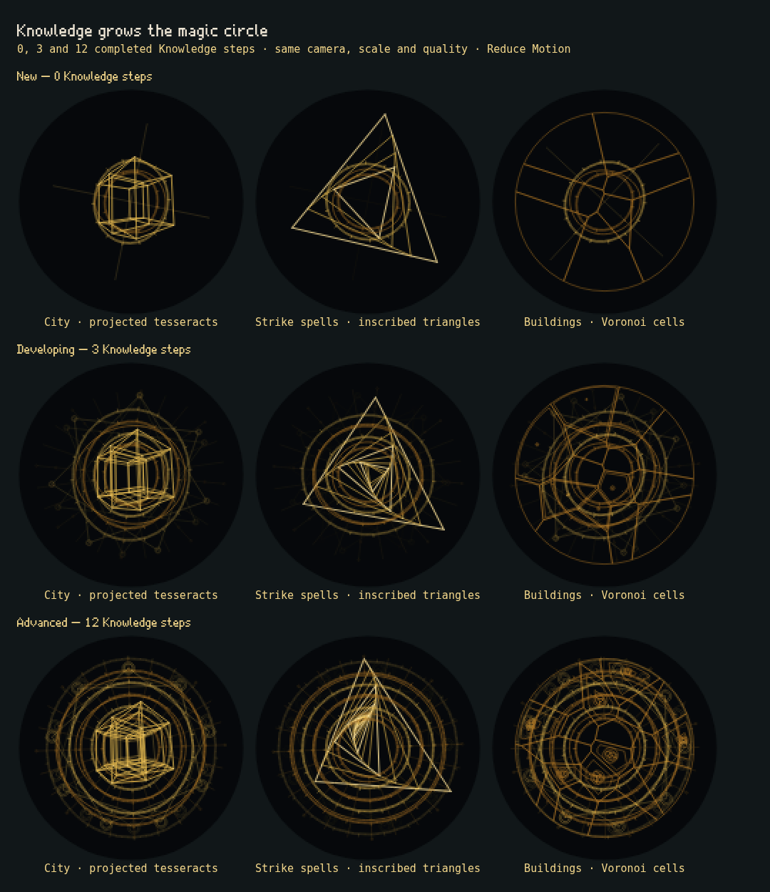

# Knowledge magic-circle progression

Magic circles become more elaborate as the player completes Knowledge upgrades. Their category stays recognizable: **city Knowledge uses projected tesseracts, strike spells use nested inscribed triangles, infantry and tower buildings use Voronoi cells**.



This is a review screenshot from the live renderer, at the same scale and medium quality for every example, with Reduce Motion enabled. The game continues to generate and morph geometry; the screenshot is not a runtime sprite. The rows count completed upgrades, not Knowledge currency prices or wallet balance.

## Visual layers

| Layer | Appearance | Growth with Knowledge |
| --- | --- | --- |
| Dark circular backing | A quiet disk behind the gold geometry, preserving the chamber behind it | Stays stable so added detail remains readable |
| Central motif | City: projected 4D wireframe. Spells: triangles genuinely inscribed in parent edges. Buildings: clipped Voronoi cells | Additional nested tesseract projections and links; more triangle layers; more cells that grow continuously from zero area |
| Concentric ring bands and graduations | Counter-rotating double rings, major ticks and finer marks | Starts with two main bands; added bands fade in and fine marks become more pronounced |
| Radial sigils | A star-like web with double-circle satellite seals | More arms, growing satellite seals and greater line presence |
| Cellular sub-patterns | Insets, small circular medallions and secondary diagrams inside selected Voronoi cells | Insets separate from the parent edges; medallions grow and richer subdivisions emerge at later progression and supported quality |
| Rails and junctions | Circular paths, radial connections and marked intersections | More rails and stronger branching connections |
| Moving lights and trails | Small lights follow the graph with bounded fading histories; static cell highlights remain under Reduce Motion | Starts with one active light; additional lights gradually become active as Knowledge grows, within the quality limit |

## Progression rules

- Each completed building transformation, path rank and crown counts as one step. The adapter reads the actual owned upgrade tree, including the steps before an evolved form. A Dark wizard keep retains the Wizard tower transformation and all three Stormcalling ranks, then adds its crown.
- Keep, wall, gate and ballista shared ranks count too. A Revolutionary includes its building lineage and all purchased ranks in its shared branches.
- Study topics count completed relevant skills, spell path ranks and crowns. Wallet changes, unrelated topics and unfinished research do not count. Starting research can still produce the existing temporary pulse.
- The kind identity and equipped spell affect shape but grant no extra progression. Equipping a previously learned path is not a new Knowledge purchase.
- Complexity uses a bounded curve, `steps / (steps + 6)`, so early purchases are visible while deeper trees retain room to grow. Ring count, symmetry, fine detail, recursion, light activity and motif counts never decrease when a completed rank is added. Path identity still changes shape, position and motion.
- New circles start with two framing rings, four inscribed triangles or eight Voronoi sites, and no recursive cell ornament. The existing limits remain: seven framing bands, twenty triangles, up to 37 sites (quality caps: 19/27/37), three tesseract projections, and 6/9/12 trail agents. Actual visible amounts depend on progression and transitions.
- Purchases and reversals retain the 1.7-second smooth transition. Undo, unlearning and respec restore the simpler target exactly. Reduced Motion shows the full progression-appropriate geometry without animation.

## Implementation and validation

`formation.ts` separates the completed `knowledge` count from deterministic shape contributions; `visualOnly` marks identity choices. `progression.ts` adapts Study data. `ui/specialty.ts` adapts building lineage and shared ranks, and Defend passes the Revolutionary ranks. `render.ts` reveals the layers, keeps clipped cell geometry cached, preserves graph-attached histories and caps work by quality. No saved geometry, new save fields, gameplay random draws, animation loops or listeners are introduced.

The Node tests cover monotonic complexity, identity choices, retained crown ancestry, Revolutionary branches, deterministic reversals, cell birth, inscribed triangles and interrupted morphs. The browser fixture exercises actual purchases, unlearning, pending research, keep upgrade/respec, building undo, reduced motion, navigation, persistent canvas ownership and the current keep/wall target API at desktop and phone widths. It also generates the reference above and measures bounded renderer work over 0/6/24-step transitions. Run it against a dev server:

```sh
PLAYWRIGHT_EXECUTABLE=/usr/bin/chromium node tests/magic-circle.mjs
```

`TEST_URL` selects the server. All browser saves are isolated; existing player saves are untouched.

Validation: all **593 Node tests** passed, including **17 magic-circle tests**; the production TypeScript/Vite build passed with its existing large-chunk warning. The actual-app browser matrix passed at **1280, 390 and 360 pixels**, including visible geometry, ring/projection growth, pending research, deterministic unlearning/respec, cell/ring reduction on undo and static reduced-motion redraws. Its older keep/wall fixture targets were updated to the current `{ side: ... }` API after the first run exposed their stale forms; no application behavior or assertions were bypassed.

The isolated 300-frame high-quality benchmark, cycling 0/6/24-step states during the full Node suite, reported **0.40 ms median / 0.80 ms p95** per `MagicCircle.frame` call in this headless Chromium session. Histories stayed at or below 24 entries, agent count stayed at 12, no extra animation frame loop was registered, and reduced-motion redraws were pixel-identical. These are renderer-call measurements, not a phone frame-rate claim. The canvas, quality caps, trail lifetimes and cached geometry refresh rate remain bounded as before; the tesseract has at most three projected shells.
