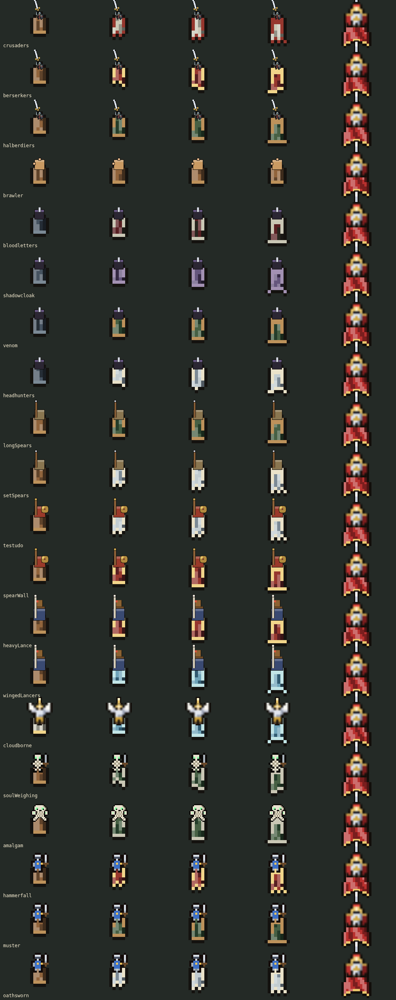

# Melee troop capes



All regular melee troop families now wear the Hero's flowing cape, tailored shorter. The Hero retains its original cape and rendering. The Shadow throws ranged knives and keeps its existing cloak; ranged soldiers, including summoned archers, receive no new cape.

| Current path tier | Cape length relative to the Hero |
| --- | --- |
| Unattuned | 60% |
| I | 70% |
| II | 80% |
| III | 90% |

These are exact chain lengths in board cells, independent of the soldier's body size, camera zoom or resolution. Frills remove cloth within that length. A Melee Guild's brawler has no attunement path and remains at 60%; the four gallery columns repeat its unattuned look. The final column is always the unchanged Hero at 100%.

Covered: Barracks swordsmen (Crusaders, Berserkers and Halberdiers), brawlers, assassins, spearmen, hoplites, mounted lancers, valkyries, melee undead/amalgams, and reinforcement knights/champions, including their descent. Styling reads the soldier's own home building's current attunement, or the battle's equipped Necromancy/Reinforcements path. An ancestor's completed path does not grant the new family's cape length early.

Unattuned capes use subdued cloth/leather, charcoal for assassins and pale cloth for valkyries. Paths follow their established hues: Crusaders get pale cloth with red edging, Berserkers crimson with torn gold-edged hems, Halberdiers green pointed hems; other paths use squared, pointed, scalloped or torn edges to suit shields, spears, wings or blades. Tier I adds side trim and tier III adds a second border. Fold lighting and hems share the existing native palette discipline.

`src/defend/melee-cape.ts` owns length ratios, path palettes, frills and drawing. The shared `hero-cape.ts` accepts a per-cape link length and optional cut while preserving its Hero defaults, the finite-link rasterization fix and all existing physics. Ordinary cape pixels use the board's eight-pixel-per-cell grid. A WeakMap keeps each soldier's simulation and reusable canvas; software-backed buffers refresh at 15Hz, staggered between soldiers, and follow body movement between updates. Offscreen capes skip drawing outside a conservative cloth margin and reset normally after long gaps. Link direction/length is computed once per raster instead of once per pixel. No battle rules, RNG, clocks or saved fields change.

New capes appear only with Pixel Art checked. Unchecked preserves existing bodies and the original Hero/Shadow art. Simple Troops skips the new capes. Reduce Motion hangs them still; cloak opacity, hit flashes, summoned fade-out, rider/body layering and merged unit outlines remain supported. They are animated procedural cloth like the Hero's cape, with no new static sprite assets or SVGs; the broader unit-body PNG migration remains pending.

Validation commands (Vite server required for browser scripts):

```sh
node --experimental-transform-types --import ./tests/pin-random.ts --test tests/defend-melee-cape.test.ts tests/defend-hero.test.ts
TEST_URL=http://127.0.0.1:5200/ PLAYWRIGHT_EXECUTABLE=/usr/bin/chromium node tests/melee-capes.mjs
TEST_URL=http://127.0.0.1:5200/ PLAYWRIGHT_EXECUTABLE=/usr/bin/chromium node tests/defend-hero.mjs
```

The tests check exact lengths and long-gap resets, per-building/spell tailoring, ranged exclusions, backward/reversing geometry, trim pixels, movement, reduced motion, repeated toggles, Simple Troops, merged outlines and unchanged unit state. The browser gallery covers desktop and phone sizes and reports a bounded 250-cape timing sample. A comparison against the previous Hero renderer produced identical pixels across 540 moving/spinning frames.

Final validation, after retaining the latest fire/ice, grave and Infantry updates from main: all **641 Node tests** and the TypeScript/Vite build passed. The desktop/phone cape matrix, existing Hero battle/tree matrix and Reinforcements drop/landing/Study checks passed. The final synthetic cape-only 250-unit sample reported p95 20.3ms at desktop size and 22.7ms at phone size in headless Chromium; this is renderer work, not a full-battle FPS measurement. The build retains its existing large-chunk warning. No gameplay golden was re-recorded.
