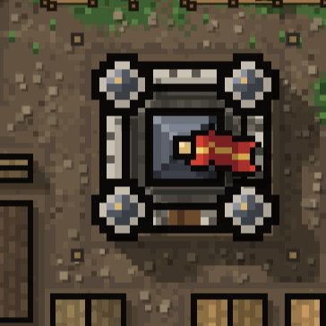

# TowerDefense pixel-art style guide

This is the art direction and implementation contract for the sprite migration. The accompanying [inventory](PIXEL_ART_INVENTORY.md) lists the work, current coverage, and source files. This document establishes the standard; it does not mark existing graphics as converted or change the renderer.

## 1. The intended look

**Clean silhouettes, deliberate pixel clusters, restrained detail, and one coherent medieval-fantasy style.** A building, a soldier, a spell icon, and a button should look like they belong to the same game.



The supplied keep is a direction reference, not a finished template. Keep its readable top-down silhouette, square central mass, four recognizable corner towers, dark separation, and simple red/gold focal accent. Improve its uneven outlines and excess tiny shading steps. Do not copy the noisy ground around it into every sprite. A sprite must read against several backgrounds, without a patch of terrain baked into its transparency.

Priorities, in order:

1. Recognizable silhouette and correct footprint/anchor.
2. Clear large material and faction shapes.
3. Consistent outline, lighting, palette, and pixel size.
4. Small details only where they improve recognition.

At ordinary play size the player should identify an archer tower, watch tower, barracks, and keep immediately, without zooming in. A higher rank earns a meaningful emblem, weapon, silhouette or roof change, not a coating of random highlights.

## 2. Non-negotiable graphics-setting contract

- **All new or revised sprite artwork, including UI, appears only when `save.settings.pixelArt === true`.** The existing Settings checkbox is `#pixel-art`. It currently defaults to checked; this plan does not change that default.
- Unchecked means the established **legacy graphics**: procedural Canvas drawings, existing UI PNGs, existing SVG theme textures, and existing presentation behavior. Preserve those renderers and asset paths. Do not reinterpret legacy graphics as a second new art style.
- Reuse `src/defend/pixel-sprites.ts` (`setPixelArt`, `pixelArtOn`, `pixelSprite`, `pixelKey`, `onPixelArt`) instead of adding competing switches. `pixelFont` is a separate font preference and must never enable the sprite migration.
- Setting off, missing asset, loading asset, or failed decode must produce the corresponding legacy drawing, never a blank box or invisible unit. Replacement rendering must report whether it succeeded before a caller skips its fallback.
- The setting applies consistently to the board, placement ghosts, drag previews, build palette, Tiles, shop, upgrade trees, journal portraits, Mine, Library, dialogs, currency bar, and navigation. An asset is not migrated until all of its appearances and states honor the switch.
- Use the saved setting before first paint. Toggling must work without a reload and must preserve the current game, navigation, drag session, timers, selections and battle state.
- Invalidate affected cached terrain, structure/damage sprites, combat frames, shadows, portraits, icons and DOM backgrounds when the switch changes or an image finishes loading. Include an art revision in cache keys. Existing `pixelKey()` is the starting pattern.
- New DOM/CSS art needs an explicit root setting hook (for example, a future `.pixel-art` class) and PNG-backed overrides. **That root class is not currently supplied by `main.ts`; it is implementation work, not an existing feature.** Scope overrides so the legacy branch remains intact, including on first load and after a Ledger redraw.
- Keep Simple square enemies/troops as intentional accessibility/performance overrides. Keep Reduce Motion, grass/water effects, health-bar and grid preferences independent. A pixel-art preference must not force animation or hide gameplay information.
- Art selection must never change collision, pathfinding, targeting, costs, damage, placement rules, RNG streams, or save compatibility.

**Current state:** [Batches 01](BUILDING_BATCH_01.md), [02](BUILDING_BATCH_02.md), [03](BUILDING_BATCH_03.md), [04](BUILDING_BATCH_04.md), [05](BUILDING_BATCH_05.md) and [06](BUILDING_BATCH_06.md) supply 61 native PNG files for all twenty-five current catalog building families, covering 406 world-state frames and 74 matching UI icons, plus flag/scaffold and normal/compact palace cloud/shadow/mooring layers. All current building paths and catalog compact forms are included. City pieces, environment art and the other unchecked inventory entries remain pending; units and enemies remain deferred. The shared loader retains the original 35 imported PNGs for other partial Defend coverage/reference. Existing baseline UI PNGs are not all controlled by the Pixel Art switch. Each replacement needs an explicit integration review; the toggle's existence does not establish complete coverage.

## 3. A single pixel language

### View, light and shape

- Defend uses an orthographic top-down view with a short, consistently south-facing visible wall/front face. No isometric diamonds, conflicting vanishing points or unrelated side-view buildings.
- Buildings do not rotate to find a footprint. Author the actual catalog orientation, plus explicitly needed directional turrets, gates, units and effects.
- Light comes from the upper left. Upper/left planes are lighter; lower/right planes are darker. Keep the same bevel and shadow direction on wood, masonry, metal and UI frames.
- Mine and Library keep their existing side-view cameras. Share the palette, outline and detail discipline; do not force their side-view objects into Defend's overhead perspective.
- Separate silhouette, material planes and important emblems. Use a single focal accent (flag, shield, lens, flame, rune) per small sprite. Deliberate asymmetry is allowed; accidental off-center walls or mismatched corner turrets are not.

### Outlines, clusters and texture

- Use a **one-native-pixel outer outline** for normal sprites. A large building may use a two-pixel structural border when all equivalent buildings do. Inside lines are darker material shades, not another black outline around every stone.
- Prefer contiguous two-to-six-pixel clusters and large quiet surfaces. Do not scatter isolated contrast pixels over roofs, stone or dirt. Isolated pixels are reserved for eyes, sparks, small fasteners and equally intentional features.
- Use three or four shades per material, normally two on small objects. No airbrushing, smudges, photographic textures, automatic gradients, bevel filters, AI-like pseudo-detail or heavy dithering.
- Follow a deliberate staircase on diagonals and arcs. Mirror pixel runs when the feature is meant to be symmetrical. Avoid random alternating edge thickness, accidental double pixels and asymmetrical corner caps.
- Static sprite silhouette alpha is **0 or 255**. Do not bake antialiased fringes, soft halos or a rectangular background into an object sprite.
- Ground is quieter and lower contrast than units, weapons and structures. Decorative terrain must not camouflage entrances, hazards, living units or placement boundaries.
- No fuzzy drop shadows. Use a small separate pixel shadow or a hard-edged mask with controlled runtime opacity. Own the shadow once; do not stack a baked shadow and a runtime shadow.

### Shared starter palette

The building collection uses this shared palette: the original 24 material swatches plus the two controlled three-color arcane/frost ramps introduced in batch 03, for 30 colors total. Each sprite uses only the swatches it needs; the per-frame limits below still apply.

| Ramp | Dark → light |
| --- | --- |
| Outline/deep recess | `#14120F`, `#28251F` |
| Stone | `#3C3B36`, `#64645B`, `#929185`, `#CAC7B5` |
| Steel | `#252D36`, `#465260`, `#7B8995`, `#C2CCD0` |
| Wood/leather | `#34271E`, `#60432B`, `#91643C`, `#BD925B` |
| Red cloth | `#581F22`, `#96372E`, `#D85A3C` |
| Brass/gold | `#6D4A23`, `#BE8D3D`, `#F1D58A` |
| Foliage | `#253D2A`, `#476044`, `#78955B` |
| Rare bright accent | `#EAE2C9` |
| Arcane/violet | `#352943`, `#65567D`, `#A391B3` |
| Frost/ice | `#325B70`, `#6FA3B8`, `#C2E5E6` |

Small UI icons should normally use at most 12 opaque colors; ordinary building sprites at most 16. Document justified larger palettes for bosses and large scenery. Add shared three-step ramps for flesh, water, frost, poison, magic and biome-specific materials as a family, then reuse them across matching units, spells and UI. Do not invent a separate frost blue or gold ramp for each file. Colored lighting and biome washes are renderer layers; author a neutral daylight base first.

Readability cannot rely on hue alone: preserve distinct silhouettes, weapon shapes, emblems, rank marks, focus rings and disabled/locked indicators.

## 4. Defend grid and sprite alignment

### Current source of truth

Use the numeric exports, not outdated comments or a screenshot measurement:

| Quantity | Current value | Source |
| --- | --- | --- |
| Board | 9 × 13 large tiles | `src/defend/grid.ts`: `TILES_W`, `TILES_H` |
| Cells per large tile edge | **8** | `grid.ts`: `SUB` |
| Placement subdivisions per tile edge | **4** | `src/defend/layout.ts`: `QUARTER` |
| Cells per small placement square | **2 × 2** | `layout.ts`: `QC = SUB / QUARTER` |
| Native Defend artwork density | **8 source pixels per simulation cell** | `src/defend/park-art.ts`: `ART` |

The resulting board is 72 × 104 simulation cells, with 36 × 52 small placement squares. Some comments still describe seven cells per tile; do not build new art around that stale value. Recheck these constants if the layout changes.

### Authoring grid

Use **8 native sprite pixels per Defend cell** for the new world-sprite family. Therefore:

| World extent | Native source extent |
| --- | --- |
| 1 simulation cell | 8 pixels |
| 1 small placement square (2 cells) | 16 pixels |
| 1 tile (8 cells) | 64 pixels |
| A 2×2-cell tower | 16×16-pixel footprint |
| A 4×4-cell keep | 32×32-pixel footprint |
| A 6×4-cell building | 48×32-pixel footprint |
| A 12×12-cell building | 96×96-pixel footprint |

These are **ground footprints**, not mandatory bounding boxes for every tall roof or weapon. The inventory contains each building's current dimensions. Read `STRUCTURES` and `footprint()` for normal and compact forms; never infer occupancy from transparent PNG margins. Gate orientation, wall edges and wall-ballista pivots use their existing geometry helpers.

Existing imported PNGs have inconsistent source density: for example `defend-keep.png` is 36×36, `defend-barracks.png` is 36×48 and `defend-watch-tower.png` is 24×24. `drawRoof()` also uses a `px / 12` source unit. Audit these adapters. **Redraw to the shared native grid; do not blur-resize those sources or globally change `ART` to make one sprite fit.**

### Anchors and placement

Every world asset must declare its native dimensions, content bounds, ground footprint, logical anchor/pivot, and overhang. Anchor metadata belongs to the sprite; it cannot depend on how much transparent padding happened to be trimmed.

- Structures: align the footprint origin to the map rectangle. A centered ground anchor is `(w / 2, h / 2)` cells and `(4w, 4h)` source pixels at this density. The keep's 4×4-cell footprint therefore has a `(16,16)` source-pixel anchor in an unpadded 32×32 frame.
- Units: anchor at the simulation position's ground/feet reference. Keep identical canvas size and pivot through every animation/direction frame. A human can use a 16×16 frame with a compact roughly 6×8 body and padding for its weapon; empty padding is not extra collision area. Respect species scale from the catalog.
- Towers, turrets and siege weapons: record the rotation center and projectile socket separately. Never rotate around a sprite's trimmed-image center. Author discrete directions where arbitrary bitmap rotation would blur the sprite.
- Shadows, damaged versions, rubble, selection outlines, build ghosts, path variants and palette thumbnails share the corresponding identity and anchor. A damage or attack frame must not move the building or make it jump between grid squares.
- Compact and wide footprints get separate authored compositions. Never squash a square building into a wide footprint or stretch its stones to fill the new box.

Example of the metadata contract (the current building-sheet layouts and frame selectors live in `src/defend/building-sprite-manifest.ts`):

```json
{
  "id": "keep/base/intact",
  "src": "defend/keep/base/intact.png",
  "size": [32, 32],
  "contentBounds": [0, 0, 32, 32],
  "footprintCells": [4, 4],
  "pixelsPerCell": 8,
  "anchorPixels": [16, 16],
  "anchorCells": [2, 2],
  "overhangPixels": [0, 0, 0, 0]
}
```

### Camera, scaling and seams

- Keep simulation positions and input hit tests unchanged. Apply the existing camera transform, then snap presentation to a shared device-pixel grid. Do not round simulation coordinates, introduce half-cell offsets, or independently recenter each asset.
- `DefendRenderer.px` and `cam.x/y` already use backing-canvas/device pixels; do not multiply by DPR a second time. A world coordinate maps to `cam.x + fx * px * cam.s` (and similarly for y). Apply any presentation snap once, consistently for sprites and associated shadows/overlays. Preserve `toCell()`/`toClient()` as inverse input transforms.
- For adjoining tiles, derive both endpoints from the same shared boundary mapping: `left = snap(x)`, `right = snap(x + width)`, width = right − left. Do not separately round a position and scaled width, which opens seams or creates overlaps. Derive a centered pivot from those shared snapped bounds; do not independently round the center again. An odd-width device-pixel rectangle can have a half-device-pixel center without being misaligned—its edges and all related layers still share the same mapping.
- Use nearest-neighbor sampling at **every** copy/composite stage, not just the final `drawImage`. Reapply `imageSmoothingEnabled = false` after canvas resize. DOM images need `image-rendering: pixelated` and integral display sizes where possible.
- Prefer integer display magnification. Fractional zoom and fit-to-screen minification cannot promise equal-width source pixels merely by disabling smoothing. Use authored lower-detail PNG tiers or one consistent nearest-neighbor board composite at overview scale. Do not change world footprints or distort individual sprites to compensate.
- `drawCity()` already disables final city-layer smoothing in Pixel Art mode; only legacy/off enables smoothing when `cam.s / layerScale < 1`. Preserve that behavior and audit each new intermediate composite. Avoid a late CSS smoothing override as the entire solution.
- Roofs, walls and floor tiles use repeatable modules, caps/corners or nine-slice layouts. One source pixel has the same visual size across a building family. Avoid stretched middle tiles, visible 1-pixel seams and resampled borders.

## 5. PNG delivery and animation rules

- **Every new sprite and sprite-sheet image is PNG. No SVG sprites, SVG export, JPEG, WebP, or image files disguised by renaming.** Existing legacy SVGs stay available for Pixel Art off.
- Use transparent PNG for objects/FX; opaque PNG for a genuinely opaque repeating surface. No antialiasing on static silhouettes. Avoid pre-enlarged pixel art: deliver the native file and let the renderer scale it.
- Replacement namespace: `public/assets/pixel/v2/{defend,ui,mine,library,fx}/`. The building batches already use `defend/` and `ui/`. Keep current imported files as references and preserve fallback paths. `pixel-sprites.ts` registers the versioned building paths from `BUILDING_ART` alongside its original flat imported IDs; extend that manifest for new building sheets instead of using unregistered URLs.
- Resolve public URLs using Vite's `BASE_URL`, including UI/CSS assets. The site runs under `/TowerDefense/`; new URLs must not assume `/assets/` at the web root.
- Use lowercase kebab-case filenames and stable semantic IDs. Suggested path: `defend/keep/base/intact.png`; animated strips use explicit frame dimensions, frame count, direction order, duration and pivot metadata. No filenames like `final-final2.png` or sprites located only in a temporary workspace.
- Adjacent sprites in an atlas require transparent gutters and explicit source rectangles. Never sample a neighbouring frame. Keep identical padding across an animation; if packed/trimmed, retain original-canvas offsets in metadata.
- Begin with a small motion vocabulary: idle 1–2 frames, walk 4 frames, attack/cast 3–4, impact/death 3–5. Use eight directional frames for gameplay-facing bodies/weapons where direction is visible. Reuse mirror directions only when light and asymmetric equipment still make sense.
- Animate via the existing game clock/frame loop. No timer per sprite, per enemy or per icon. Reduced Motion uses an intentional readable still frame; it must never remove a hazard or gameplay cue.
- Preload a shared atlas or shared image once. Reuse cached images/source rectangles for crowds; do not create a new image, canvas, animation or recolored copy per enemy per frame. Performance-test the crowded waves already supported by the game.
- Existing fonts and dynamic text stay actual text. PNG button faces must not bake in labels, prices or translations. Interactive targets remain DOM controls with accessible names/focus states; pixels do not determine hit boxes.
- Live geometry (reach circles, grid overlays, node connectors, progress bars, charts and evolving magic circles) remains data-driven. Rasterize it on the shared pixel grid using PNG markers/brushes where appropriate. Do not export whole trees, labels or every possible magic-circle configuration into screenshots. This is not permission to add new SVG art to pixel mode.

## 6. Required asset states and cross-screen reuse

A base sprite is only one row of a family. Specify which states apply, and mark genuinely inapplicable states explicitly:

| Family | Required states/variants |
| --- | --- |
| Buildings | Normal and compact/wide footprints; every Knowledge path/rank and evolved form; intact, three damage stages, rubble; construction/rebuild; firing/working components where applicable |
| Gates/walls/ballistas | Each orientation; joining/corner/end caps; open/closed/moving gate; upgrades, damage, rebuilding; weapon directions/projectile sockets |
| Friendly units | Directions; idle, walk, attack/cast, hit, death; role/equipment/path differences, shield/cloak/poison/risen/champion states that gameplay uses |
| Enemies | Distinct species and size tiers; move/attack/hit/death; armor/parts, shields, ranged weapons, split/hatch/egg states and special status effects |
| UI | Normal, hover, pressed, selected, disabled/locked, keyboard focus; ownership/rank/cooldown/availability indicators as overlays, with readable labels |
| Terrain/scenery | Seamless repeat variants; joining edges/corners; damage/charred/burnt/rebuild states where relevant; biome, snow/ice/wet changes and lighting compatibility |
| FX | A bounded PNG animation or mask family for each effect; visible static/reduced-motion fallback; shared palette, density and anchors |

Use the same design identity on the board, icon, palette/ghost, upgrade node and journal/portrait. Author a simplified 16/24/32-pixel UI icon when a world sprite becomes illegible at that size; do not shrink a detailed castle arbitrarily and call it a finished icon.

## 7. Rollout order

1. **Foundation:** capture the legacy/off reference scenes; lock the shared palette; implement the gated registry/metadata and shared scale/anchor checks. Audit existing 35 PNGs and UI gating.
2. **Style calibration:** make keep, one 2×2 tower, one infantry building, a soldier, an enemy, a ground/wall sample, and matching UI icons as a contact sheet. Approve them together at native size and actual mobile size. Fix the common style here.
3. **One complete vertical slice:** keep family plus states, ghost, palette/tree/portrait use and cached shadows, followed by one tower and one infantry family. Test each batch with Pixel Art both on and off.
4. **Defend breadth:** remaining buildings and all paths, units/enemies, weapons/spells/FX, terrain and all biomes.
5. **Whole-game consistency:** UI/chambers, Mine, Library and laboratory, then remaining decorations. Every stage retains the legacy branch and adds a checklist entry in the inventory.

No bulk generation of hundreds of mismatched assets before the calibration set. Existing imports are candidates to redraw, not automatically the approved style.

## 8. Review and acceptance checklist

- [ ] PNG signature, native dimensions, palette and alpha pass validation; no SVG sprite is introduced.
- [ ] Silhouette remains clear at actual mobile size and on light/dark/biome backgrounds.
- [ ] No noise, muddy resampling, inconsistent outlines, baked lighting direction conflicts or unexplained pixel-density changes.
- [ ] Footprint matches the catalog; 8-pixel/cell density, anchor, overhang, direction frames and projectile sockets are documented.
- [ ] Same object stays centered through idle/move/attack, damage, upgrading, compact mode, placement/dragging, camera pan/zoom and DPR changes.
- [ ] Adjoining surfaces have no gaps. Test corners, boundary-adjacent placements, multi-tile structures and open ground as well as the city interior.
- [ ] All relevant states and appearances in the inventory are covered; missing/loading/failed art has a usable legacy fallback.
- [ ] Pixel Art off restores the pre-migration graphics on every screen and after reload. Turning on/off repeatedly does not leave mixed stale caches or multiply listeners/animation loops.
- [ ] Verify desktop and 360/390 CSS-pixel mobile layouts, DPR 1/2/3, overview and close zoom. Compare seeded, frozen scenes in the same browser; do not overwrite a player's save or regenerate gameplay goldens to accommodate artwork.
- [ ] Verify independent Pixel Art/font settings, Simple square modes, Reduce Motion and disabled grass/water effects.
- [ ] No balance, simulation state, RNG, collision or pointer mapping changes; replay/save tests remain valid.
- [ ] Record art memory and frame cost on the existing crowd/stress fixtures. Cache by visual state/size/revision and bound the caches.
- [ ] New UI keyboard focus, hit targets, prices and contrast remain readable and usable.

Existing starting checks are `tests/settings.test.ts`, `tests/building-sprites.test.ts`, `tests/pixel-art.mjs` and `tests/building-sprites.mjs` (browser scripts need a dev server), plus `test:pointer`, `test:render-cache`, and the affected scene's browser tests. The pixel-art browser test now validates the full live registry. Add on/off checks for UI, Mine, Library, damage and path variants as they are converted. Run repository-required tests and the production build for implementation batches.
