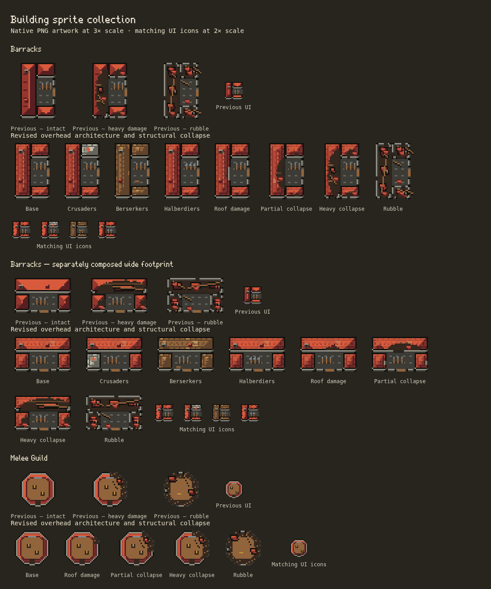

# Roof material detail

The user welcomed the architectural revision and clarified that **clean pixel art means consistent pixel size and crisp construction, with room for realism**. Roofs should show believable materials, tile color variation and aging. This pass adds that detail to the revised **Barracks (normal/wide and paths)** and **Melee Guild** while preserving their plans and damage layouts.



The image shows actual runtime PNGs at 3× native size and UI icons at 2×, compared with originals from `5fa96c4`. Native density remains eight pixels per simulation cell. Individual tiles and clusters contain several native pixels; none introduces a different pixel scale or antialiased edges.

## Materials

- Terracotta uses staggered courses, connected overlap/end-joint shadows, warmer and darker tiles, a few weathered clay tiles and segmented ridge caps. Upper-left roof planes remain lighter than lower-right planes. Color variation follows whole tiles rather than arbitrary surface noise.
- Berserkers retain timber shakes, with staggered joints and a warm wood ramp. Crusaders retain a pale chapel wing with cooler tile variation. Both share the same pixel grid and lighting.
- Damage reveals the existing floor and rafters. Texture coordinates stay attached to the intact roof, so surviving tiles keep their appearance as a breach grows. Fallen roof panels carry the material detail into ruins.
- Separately authored 24×24 icons use fewer shades and seam marks appropriate to their space. They depict the same architecture and materials.

`roofTile` in `scripts/pixel-art/architecture.ts` generates the texture during PNG authoring. It does not run in the browser or use simulation randomness. Four shared swatches (`tileShade`, `tileClay`, `tileSun`, `tileWorn`) extend the existing red ramp, bringing the collection palette from 30 to 34. Frame limits remain **16 opaque colors for world art and 12 for UI**. The updated guide makes material realism part of the intended direction for future sprites.

## Delivery

Five files change under `public/assets/pixel/v2/`: `defend/barracks.png`, `defend/barracks-wide.png`, `defend/melee-guild.png`, `ui/barracks.png` and `ui/melee-guild.png`. All other **56 native PNGs are byte-identical**. Every revised frame/icon retains the exact dimensions and alpha mask of its predecessor. No footprint, anchor, silhouette, collision or damage layout changes.

The collection remains 61 files with 406 world-state frames and 74 UI icons, decoding to **2,124,544 RGBA bytes**. These five files still decode to **277,760 bytes**. There are no new assets, runtime passes, per-building allocations or caches. Pixel Art continues to gate the replacements and legacy/missing-PNG fallbacks remain in place. This pass changes the roofed calibration families; other building families retain their earlier material treatment. Units and enemies remain deferred.

Rebuild with `npm run sprites`; verify with `npm run sprites -- --check`. With a dev server running, generate the focused contact sheet and exercise the whole collection:

```sh
SPRITE_KINDS=barracks,meleeGuild \
PLAYWRIGHT_EXECUTABLE=/usr/bin/chromium node tests/building-sprites.mjs
```

The comparison uses optional `SPRITE_COMPARE_DIR=test-results/roof-materials/before`, containing `defend/` and `ui/` originals from `5fa96c4`. Historical files are unnecessary for ordinary validation.

## Validation record

- Full `npm test`: **590 passed, zero failures or skips**. The production TypeScript/Vite build and reproducible PNG check passed; the build retains its existing large-chunk warning. All 61 native PNGs were copied byte-for-byte into production output. No gameplay golden changed.
- Final targeted PNG checks: three passed, including reproducible output, palette/opaque alpha, fixed footprints/anchors and structural damage contracts. A separate byte/alpha comparison verified five changed sheets, 56 unchanged sheets and identical masks throughout the changed sheets.
- Final browser matrix passed all 406 world-state frames at 1100px/DPR1, 390px/DPR2 and 360px/DPR3. This covers native frame/icon parity, paths and ruins, reconstruction, placement/drag, camera sampling, motion, repeated toggles, exact legacy output and missing-asset fallback, including existing compact/airborne palace checks. An intermediate run against the dev server used during source editing failed the airborne legacy comparison; final validation on a freshly started server passed without changing or disabling that assertion.
- The existing stress fixture completed 120 recorded frames with 500 requested enemies (513 average including spawned enemies): update mean **1.94 ms**, drawing mean **42.20 ms**, combined work p95 **86.80 ms**. This whole-scene diagnostic used headless Chromium 154 with SwiftShader/software Canvas while the Node suite ran concurrently. It is not an isolated sprite measurement or a player-device frame-rate claim. Profiles and JSON are in ignored `test-results/stress-roof-materials.*`.
