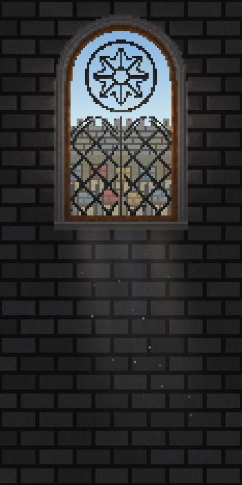

# Window light and the Tiles stained glass

The Library and Tiles hall share `src/soft-sunlight.ts`. Each renderer caches three small light-density textures once. Their cross-section has a Gaussian feather, a smooth source fade and a gradual distance fade. Each frame shears these fields with the solar heading and composites them with `screen`. The fields overlap at low opacity; their edges dissolve instead of outlining transparent polygons. Only light is interpolated: stone, oak, lead and the rest of the scene keep their existing crisp sampling. There is no full-scene blur or per-frame texture allocation.

Tiles follows the Library's eight-minute day, with a small additional slow sway. Its thirty dust motes follow stable wall-clock trajectories through the shafts, fading at both ends; they use no gameplay/effects random stream, new timer or save state. Night removes the sunlight and illuminated interior dust. Reduce Motion freezes the Tiles solar heading and omits its drifting dust. The Library retains its existing effects/Reduce Motion behavior and motes.

With Pixel Art checked, the existing procedural Tiles window uses symmetrical native-grid leadwork: an eight-petal rose with a central eye, paired pointed lower panels and larger diamond panes. Its glass is predominantly clear, with faint blue and cream glazing over the existing sky, hills and city. Lead has a consistent material tone instead of random bright specks. Switching Pixel Art off rebakes the original four-lobed clear-glass window; toggling back works at the same size without reloading. The soft atmospheric lighting is shared by both art modes. This revises the existing procedural backdrop; it adds no sprite assets and does not complete the pending PNG room/scenery migration.

Tuning:

| Control | Location |
| --- | --- |
| Light intensity | `SUNLIGHT.density` in `src/soft-sunlight.ts`; callers also pass daylight/pulse strength |
| Edge softness and widening | `SUNLIGHT.feather` and `spread` |
| Fade with distance | `SUNLIGHT.distanceFade`; source fade in the texture bake |
| Motion | `SUNLIGHT.sway` / `swayMs`; solar period remains `DAY_MS` |
| Dust density and speed | `SUNLIGHT.dustCount`; trajectory periods in `HallBackdrop.drawSunlight` |
| Pane colors and transmission | Glass tint mix in `HallBackdrop.draw` |
| Tracery and pane layout | `windowPane` in `src/ui/hall-art.ts` |

No runtime blur or layer-count control is needed: the cached continuous density replaces nested polygons. Three fields are drawn in Tiles and five in the Library, with three reusable 96 × 192 textures per renderer.

`node tests/hall-sunlight.mjs` checks soft edge falloff, changing sunlight/dust, night, Reduce Motion, native symmetry and repeated art toggles at 1280/390/360 pixels. It captures both the real Tiles UI and an unobstructed window under `test-results/tiles-sunlight-*` and `tiles-window-detail-*`. Run against a dev server with `TEST_URL` and `PLAYWRIGHT_EXECUTABLE` as needed. Existing `tests/library-idle.mjs` and `tests/tiles-marks.mjs` cover live Library rendering and Tiles interactions.

Validation passed: all 630 Node tests, the TypeScript/Vite production build, the three-width window matrix, Library idle/fire/mobile browser checks, and Tiles stacking/detail interactions at desktop and phone widths. The build retains its existing large-chunk warning; no gameplay golden changed.
