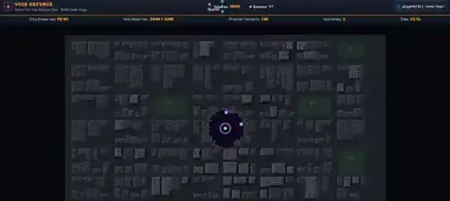
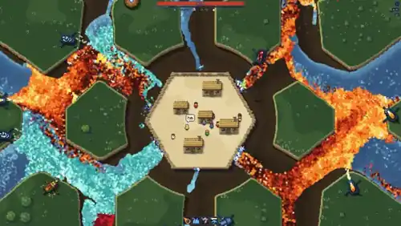
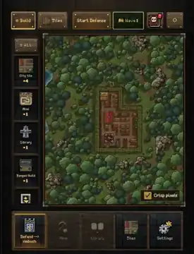
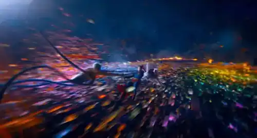
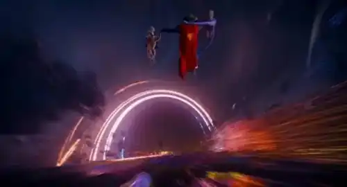
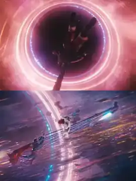
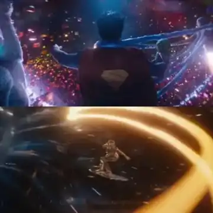

# Void Defense: Visual references and acceptance targets

**Purpose:** Visual art-direction references supplied by the user. These are not game assets or instructions to reproduce existing film/game artwork. Source images were resized to compact WebP documentation previews. They should not be bundled into the shipped game.

## A. Current prototype versus desired environmental richness

**Current Void Defense prototype (unaccepted visual baseline)**

Current weaknesses visible in this frame: nearly uniform dark-gray buildings and streets; repetitive rectangular rooftop silhouettes and speckled orange lights; faint destruction/particle activity; low visual depth; circular Void with limited spatial spectacle; prototype-style information HUD. This screenshot **does not** prove any particular implementation bug.

**Desired gameplay density, layering, and energetic flow (another game, visual reference only)**

**Borrow the visual principles, not the specific game's imagery or gameplay:** dense, tactile pixel detail; readable terrain at wide zoom; broad, interlocking flows of color; strong material separation; lighting at the boundaries of interacting substances; localized destruction and movement; an immediately legible center of conflict. Translate those qualities into **a futuristic megacity, matter construction and a cosmic Void**, not a medieval landscape or fire/water clone.

**Original TowerDefense craftsmanship benchmark**

This is the polish benchmark for art fidelity, visual depth, terrain composition, object individuality and tactile UI. Keep Void Defense's larger simulation and smaller people; **do not upscale people or return to its small-kingdom geography** merely to get this level of detail.

## B. Cinematic cosmic-anomaly color and motion references

The following four stills are user-provided references from the recent *Superman* movie. They illustrate the intended **color energy, radial motion, refractive rings and starlit particles**. They are **reference-only third-party imagery**, not art to trace, reproduce or ship with the game.

**1. Prismatic particulate flow**

Use for chromatic motion ribbons, debris arcs, foreground/background energy separation and dense streamlines, translated into top-down pixel particles and selectively higher-resolution glow.

**2. Portal-scale curved luminance**

Use for a memorable portal-source silhouette, elliptical or concentric event-horizon lines, brilliant edges and directional material pull. The broader eroding Void frontier **must remain organically shaped** and must not always be a perfect circular ring.

**3. Event-horizon contrast and depth**

Use for near-black interior, bright thin inner rim, restrained wider chromatic halo, and value contrast. Avoid filling the whole map with saturated glow that masks the city or units.

**4. Multi-hue energy turbulence**

Use for lensed star particles, orange/cyan/magenta/violet interplay, turbulent arcs and dramatic, high-energy moments like landfall impacts or portal surges.

## C. Final art-direction rules

1. **Projection and scale:** Overhead by default, not side-view. The metropolis should feel *massive*, with streets and recognizable districts; soldiers are **1x1 art pixels** and larger personnel are **1x2 or 2x2 art pixels**. Do not resize everyone to make the image appear detailed.
2. **City:** Layer varied rooftop materials, distinct footprints and setbacks, height-coded shadows, roof utilities, avenues, lit infrastructure, transport, defense stations, evacuation/damage, and warm human technology. Avoid an undifferentiated grid of gray rectangles.
3. **Void:** Organic deforming frontiers around a deep black star/nebula-filled interior, thin spectral rims, localized prismatic turbulence and inward-pulled chromatic debris. Reserve the strongest event-horizon rings for source portals, surges and major strikes.
4. **Effects:** Render terrain and units as crisp pixel art. Use composited particles, cached emissive layers and carefully bounded screen-space glow/distortion to create the cinematic *sensation* without replacing pixel art with blurry gradients.
5. **Readability:** Keep important targets and actions clear by motion, contrast, emissions and overlays. Reduce detail away from active areas when zoomed out. Never have every building light at maximum intensity.
6. **Art performance:** Dirty-chunk/static rendering, LOD, bounded light sources and adaptive particles; benchmark both desktop and mobile in a **busy** siege, not just an idle screenshot.
7. **UI:** A futuristic orange/graphite command console with the same design intentionality as TowerDefense's tactile interface, but no leftover medieval visual vocabulary.

## D. Acceptance examples to capture before approval

- **Overview:** full-city screenshot at default gameplay zoom, showing coherent metropolitan districts, nonrepetitive buildings, visible streets and a clearly threatening Void.
- **Active frontier:** zoomed-in and default-zoom captures while buildings break into luminous particles and workers/defenses reclaim terrain.
- **Portal/strike spectacle:** at least one visibly multilayered event-horizon surge and one Landfall/reclamation strike, with crisp pixels and controlled bloom.
- **Living city:** normal-zoom soldiers, 1x2 engineers, tower fire, and active construction clearly distinguishable while remaining tiny.
- **HUD:** readable redesigned command-console interface without overlapping counters.
- **Comparison and performance:** side-by-side old/new screenshots using the same seed and zoom where possible, plus actual render/sim/frame-time measurements; capture a no-effects/reduced-motion variant.

**Do not mark the visual acceptance gate complete until the user reviews and approves representative screenshots.** Code passing tests and containing every planned feature is not sufficient.

## Asset provenance

All seven images above were supplied in the conversation and converted to compact WebP documentation previews. Game screenshots are comparisons, not a specification to copy another game's intellectual property. The four cinematic film stills remain copyright of their respective owners; use for private design study/reference and do not use as in-game sprites, textures or promotional assets. If the repository is made public, review whether these third-party previews should remain committed.
